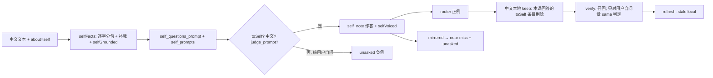

# Self 模式：把角色教成模型的自我认知

状态：设计稿第 3 版（未实现）。按 `review-self-mode-req.md`、`review-self-mode-essence.md`、`review-self-mode-v2.md` 与主 agent 裁定修订，逐条回应见 §10。
代码行号以 HEAD 为准；中文人称修复已在 `11ee183` 提交（§5.1）。需求行号以当前工作区的 `需求原话.md` 为准。凡未经代码核实的判断标注 **[推断]**。

---

## 1. 定位

给 Living Weights 增加第三种"事实关于谁"的模式 `self`。现有两种是 `user`（"我喜欢蓝色"→ 关于用户）与
`document`（文档里关于某人某物）。`self` 让事实关于**模型自己**：学完后问"你是谁"答"我是埃利亚斯·索恩"，问"你生日是哪天"答"1月15日"。

现状**刻意禁止**这一层：

| 禁止点 | 证据 |
|---|---|
| 训练问题必须是用户问自己（I/my/我） | `slide_take.zig:101-105`、`slide_lesson.zig:468-469` |
| 问模型的问法被当作负例 | `slide_lesson.zig:443`（near miss）、`slide_route.zig:22`（router 负例） |
| 问模型的保持问题每课要求不变：英文 `keep_prompts`（`slide_prompts.zig:13-16`）与其中文译本（`slide_lesson.zig:169`） | `slide_lesson.zig:143` 的 `!toModel(q)` 使英文条目永不 stale；中文译本整体 `appendSlice` |
| 作答系统提示把事实说成"用户告诉你的" | `slide_prompts.zig:228` `told_note` |
| 用户事实判定器只问"用户说的关于他们自己的事是否回答" | `slide_prompts.zig:254`、`slide_take.zig:242-246` |

self 模式把正负例**镜像**：问模型（你）的问题是正例，用户问自己（我）的问题是负例。

**只做中文**（`需求原话.md:16`：英文问法不要求，中英孪生方案作废）。self 模式只收中文自述事实，只学中文问法；
问 `Who are you?` 不保证答角色。设计里不为英文问法增加任何机制。出现的英文要么属于 user/document 原有路径，要么是代码库给基模型的指令文字（§3.3），各处写明理由。

角色设定渗入普通对话**可接受且视为特点，不设门槛**（`需求原话.md:9`、`:24`）。唯一保留的保护是：
**不得把角色事实安到用户头上**（"我的生日是哪天？"不得答"1月15日"），以及普通请求仍被回应（不拒答、不崩坏）。

范围外：LoRA（已否决，`需求原话.md:14`）；英文问法（不要求，`需求原话.md:16`）；角色事实的替换/更新。

---

## 2. API

沿用 `POST /v1/slide/learn`（`routes.zig:66` → `slide.zig:66 learn`），新增可选字段：

```json
{"text": "我1月15日生。", "about": "self"}
```

| `about` | 行为 |
|---|---|
| 缺省或 `"user"` | 现状：`source` 决定 chat/document（`slide.zig:76,111`） |
| `"self"` | self 模式：忽略 `source`；事实在图中记为 `source: "self"`。只收中文自述（§3.2）；全英文文本得到现有的 `failed: no facts found in the text`（`slide.zig:91-95`） |
| 其他值 | `400 about must be "user" or "self"`，走 `slide.zig:75` 同一 `refuse` 路径 |

SSE 事件不变。图不加字段：`source` 显示为 `self`（`slide_panel.js:63,95` 直接显示字符串）；
`slide_graph.zig:110 learnedChat` 只取 `source == "chat"`，self 事实与用户事实互不替换。omp 扩展（`packaging/omp/sliding-weights.ts:104`）不改。

---

## 3. 逐步行为契约

### 3.0 模式枚举

`slide_whom.zig` 新增：

```zig
/// Whom a lesson's facts are about: the user (told in chat), a document's subjects, or the model itself.
pub const About = enum { user, document, self };
```

`slide_lesson.zig`、`slide_take.zig`、`slide_think.zig`、`slide_verify.zig`、`slide.zig`、`slide_replace.zig` 中的
`document: bool` 整体换成 `about: About`（干净切换，不留 bool 版本）：`document == true` ⇔ `.document`，`false` ⇔ `.user`。
user/document 的每个分支原样改写；`.self` 是新增分支。

保留枚举而不另起一套 self 专用函数（essence C10）的理由：self 课需要与现有课程完全相同的保持集、held-out 校验、
near miss、router 数据与轮次逻辑（`slide.zig:145-219`）。另起一套就要复制 `lesson`/`factLesson`/`routerData`/`verify` 四个最长的函数。
枚举替换是机械改写，有现有测试和 §6.3 R3 的日志比对兜底。

三处重复的作答 note（`slide_take.zig:107`、`slide_lesson.zig:493`、`slide_verify.zig:107`）收敛为
`slide_take.noteFor(a, about, fact)`：`.user`→`told_note`，`.document`→`read_note`，`.self`→`self_note`。

### 3.1 人称判定（`slide_whom.zig`）

**`toSelf(q) = toModel(q) and !firstPerson(q)`**：问的是模型自己。两个函数都**不改**：
- 中文部分已在 `11ee183`：`toModel` 认 你/您（`:63`），`firstPerson` 认 我/咱 与 你的/您的/你自己（`:52-55`）。
- 两者原有的英文分支（`:42-48`、`:61-62`）是 user 路径必需的（`slide_lesson.zig:143` 与 `slide.zig:111` 等），保留不动。self 模式不依赖它们：英文问题在 `sameScript`（`slide_take.zig:102`）处已被丢弃。

结果：`你是谁？`、`你的生日是哪天？`、`介绍一下你自己。` 为真；`我的生日是哪天？`、`你还记得我的生日吗？`、`告诉我你是谁`、`法国的首都是哪里？` 为假。
同时含"我"和"你"的句子（如 `告诉我你是谁`）`firstPerson` 为真，因此 `toSelf` 为假，不作正例；§3.5 规定它也不作负例。

**`mirrored(a, q) !?[]const u8`**：把"问模型"改写成"用户问自己"，只处理中文：`你`→`我`、`您`→`我`（`std.mem.replaceOwned` 两次）；两字都不含时返回 `null`。
与 `addressed()` 的中文分支（`:93-98`）对称；`addressed` 不改。
保留理由：它就是负例镜像本身。现有用户自问的保持集是固定的英文列表（`slide_prompts.zig:48-57,73-163`）加 8 条译文（`slide_teacher.zig:109`），
覆盖不到"我多高"这类逐事实的中文用户自问。

**`selfVoiced(answer) bool`**：答案含 `你的` 或 `您的` 时为假，否则为真。
保留理由：它拦的是唯一会把镜像教反的失败，即把 `你生日是哪天？` 教成 `你的生日是1月15日`，也就是把角色事实说成用户的。

### 3.2 事实摄入

现状（`slide_found.zig:17-25`）：chat 来源且不超过 4 句时按句切（`:20`），否则用 `facts_prompt` 抽取，并用
`grounded()`（`slide_words.zig:198-214`）要求事实的数字、名字、CJK 字对都出现在原文。

两条路径都不适合第一人称角色文档：
- 按句切按 `。！？` 或"后接空白的 ASCII `.!?`"断句（`slide_units.zig:5-13`），所以 `1月15日生,今年28岁。` 是一整句，主语省略，
  `firstPerson` 为假。
- 在句首补"我"时，`我` 会与后一个汉字组成原文没有的字对（`我今`），`grounded()` 因此拒绝（按 `Units` 成对规则推演，`slide_units.zig:119-133`）。

self 模式新增 `slide_found.selfFacts(srv, cx, text, gone) ![]const []const u8`，**不走** `facts()` 的按句分支：

1. 按 `chunk_chars`（`slide_found.zig:14`）分块，每块以 `askBase` 发 `self_facts_prompt`，唯一实参是块文本。
   提示要求逐字抄原文的短分句，一句多事实时按分句拆开，分句不以"我"开头时只在前面补"我"、其余一字不改。
2. 逐行 `wording.unmark`，再按顺序过滤：
   - `words(fact) >= 3`（同 `slide_found.zig:97`）；
   - 含"我"且 `firstPerson(fact)`：只收中文自述（`需求原话.md:16`），英文 `I …` 行在此丢弃，日志 `"... is not told in Chinese of itself, so it is not learned"`；
   - `selfGrounded(fact, text) = grounded(fact, text) or (fact 以"我"开头 and grounded(fact["我".len..], text))`，不引入新阈值；
   - 与已收事实 `restates()` 去重（`slide_found.zig:111`）。
3. 不做 `reversed()`；不做"无示例重问"。提示里的示例行即使被照抄，也会被 `selfGrounded` 拒掉。

`slide.zig:90` 在 `.self` 时改调 `selfFacts`，`slide.zig:98` 以 `"self"` 作为 `source`。

### 3.3 问题生成

所有课程提示都是写给基模型的英文指令，中文事实的 `_other` 变体也是（`slide_language.zig:14-23`）。self 的新提示沿用这一惯例，用英文指令要求中文输出。这不是英文问法机制。

| 环节 | 现状 | `.self` |
|---|---|---|
| 首批与补问 | `questionsFor()`（`slide_lesson.zig:556-559`），补问见 `:331-350` | `questionsFor(.self)` 返回 `self_questions_prompt`，实参依次为 `{fact, count, count}`（与 `questions_prompt` `:218` 同序）。提示要求写中文问题、称对方为 你/你的，示例为 `我1月15日生。` → `你的生日是哪天？你是哪天出生的？` |
| 身份规范问法 | 无 | `slide_lesson.zig:350` 之后对 `.self` 调一次 `take(..., &prompts.self_prompts, ...)`，`self_prompts = { "你是谁？", "你叫什么名字？", "介绍一下你自己。" }`。由 `take` 的判定器筛掉该事实不回答的条目。保留理由：效果 1 点名"你是谁/你叫什么"（`需求原话.md:21`），生成器对身份事实不保证给出这两种问法 **[推断]**；成本是每课 3 次判定 |
| 其他值是非题（`:352-360`） | 仅英文 user | 条件改为 `parts.about == .user and language == null`；self 事实是中文，`language` 不为 null，原条件已跳过，改写只为表意 |
| "Do you remember…" 改写（`:362-371`） | 非 document | 条件改为 `parts.about == .user`，self 跳过 |
| `aboutEntity`（`:314`） | 模型判定 | `.self` 时恒为 `false`：回复首行作 key，与用户事实同一机制（`living-weights.md:95`） |
| besides（`:418-423`） | 关于同一主体但事实不回答的问题作 near miss | `.self` 整段跳过（essence C8）。代价见 §8 第 4 条 |

### 3.4 过滤（哪些问题成为训练正例）

| 位置 | 现状 | `.self` |
|---|---|---|
| `slide_take.zig:101` `write()` | `personal = !document and (!firstPerson(q) or someoneElse(fact,q))` | `personal = !toSelf(q)` |
| `slide_take.zig:102` | `sameScript` 加 `judged(document)` | 不变（`sameScript` 丢掉英文问题）；`judged(.self)` 走 `.document` 分支（`judge_prompt`，`slide_prompts.zig:248`，实参 `{fact, question}`）。判定器只会收到 `toSelf` 为真的问题，不需要另写 self 判定提示 |
| `slide_take.zig:103` 日志 | "is not the user asking what the fact answers" | `.self` 时为 "is not a question about the model itself" |
| `slide_lesson.zig:468-469` `routerData` | 同上 `personal` 与日志 | 同 `write()` 的 `.self` 规则 |
| `slide_lesson.zig:588-593` `answered()` | `!document and someoneElse` 返回 false | `someoneElse` 只在 `.user` 时检查（它是英文代词表，`slide_whom.zig:112-122`，对中文问题无作用） |

`siblingAnswers`（`slide_take.zig:176-204`）只把 `document` 换成 `about`，`judged(.self)` 同上。

### 3.5 答案生成与负例镜像

**答案**：

| 环节 | 现状 | `.self` |
|---|---|---|
| 作答 note | `told_note`/`read_note`，作 system 消息 | `self_note = "This is true of you, and you say it of yourself: \"{s}\" Answer as yourself, in the first person, in Chinese, plainly."`，唯一实参为 fact。`noteFor` 返回 `Note{text, in_turn}`，`.self` 的 `in_turn = true`：经 `askNoted` 拼在 user 消息开头，不放 system。实测（s3，2026-10-13）：同一 note 作 system 时，"你的生日是几号？"出厂答"我的名字是Nemotron"，拼进 user 则答"我的生日是1月15日。"。用于 `write()`、`shortAnswer`、`verify.knowing` |
| 第一人称 | 无 | `slide_take.zig:115` 之后：`.self` 且 `!selfVoiced(answer)` 时记日志 `"... is not said as itself, so it is dropped"` 并丢弃 |
| thinking 召回行 | `recall_start`/`read_start`（`slide_think.zig:20-21`），中文 user 事实也用这两行英文 | 新 `self_start = "I know this about myself: \"{s}\""`，唯一实参为 fact；`thinkingAnswer(…, about)`（`:64-67`）按 about 选行。用英文是沿用召回行的现有格式，不是英文问法 |
| systems/turns 下再学（`slide_lesson.zig:402-407`） | — | 不变。客户端写了系统提示时模型也自称埃利亚斯，属可接受的渗入 |

**负例镜像**：

| 位置 | 现状（user） | `.self` |
|---|---|---|
| `slide_lesson.zig:443` | 每个已学问题的 `addressed()` 作 near miss | 改用 `mirrored()`，例如 `我的生日是哪天？` |
| `slide_lesson.zig:444-447` | `about(q, 亲属)` | 不改：`about()` 只认英文 `my`/`I`（`slide_whom.zig:125-151`），对中文问题返回 `null`，self 下不产出 |
| `slide_lesson.zig:472-473` | 被拒的、非 `firstPerson` 的问法进 `unasked` | `.self`：`other = firstPerson(q) and !toModel(q) and sameScript and !gives`，只有"纯用户自问"（含我、不含你/您）才进负例。`告诉我你是谁` 这类两可问法既不作正例也不作负例 |
| `slide_lesson.zig:525-530` `slide_route.others()` | 亲属、同类替换，加 `addressed()` | `.self` 不调 `others()`（亲属与同类替换都依赖英文 `my`，`slide_route.zig:15-21`，`subject` 为 null），改为 `if (mirrored(q)) \|m\|` 去重后进 `unasked`。`slide_route.zig` 不改 |
| `slide_lesson.zig:503-519` | — | 不变。镜像 near miss 自动在 systems/turns 下也作负例 |

### 3.6 Keep 集（`keep_prompts` 冲突的解决）

冲突：self 课的正例 `你是谁？` 与中文本地 keep 直接冲突。`local()` 把 `keep_prompts` 译成中文（`slide_teacher.zig:108`），
`slide_lesson.zig:169` 每课整体 `appendSlice`，其中含 `你是谁？`/`你多大？` 等问模型的条目。

规则（`.user`/`.document` 不变）：

1. **`answeredByAny` 的 `.self` 分支**（`slide_lesson.zig:543-547`）：`taught(own, q)` 为真则返回 true；`!toSelf(q)` 则直接返回 false，
   不调判定器；否则对每个 kept 事实调 `answered(fact, q, .self)`，**不加** `shares()` 前置（`我是埃利亚斯·索恩` 与 `你是谁？` 没有共享的字对）。
   开销：personal/untold/bank/local personal 各条的 `ask` 与 user 模式相同（`:119-168`）；`!toSelf` 的条目省掉判定调用，所以 self 课的调用数不多于 user 课。
2. **英文 keep**（`:142-149`）：**不改**。`.self` 下英文 `keep_prompts` 全部按原样保持：问模型的 4 条被 `!toModel(q)` 短路；其余条目在 `.self` 分支中 `!toSelf` 返回 false。
   所以 `stale_keep` 恒为空，英文 `Who are you?` 保持原答案。这符合"英文不要求"（`需求原话.md:16`），风险见 §8 第 6 条。
3. **中文本地 keep**（`:161-170`）：`Local`（`slide_teacher.zig:99`）新增 `keep_questions: []const []const u8`（即 `:108` 的 `keep_lines`），
   `keep` 改为 `[]api.Example`。`.self` 时逐条处理：满足 `toSelf(keep_questions[i]) and answeredByAny(...)` 的下标进新的 `stale_local`，其余照常加入 keep。
   `.user`/`.document` 仍整体 `appendSlice`。
4. **课后刷新：并入现有 `refresh()`**（`slide_teacher.zig:79-96`）：
   - `Stale`（`:76`）新增 `local: []const usize = &.{}` 与 `language: []const u8 = ""`，由 `lesson()` 在 `:196` 填入。
   - `refresh` 的早退条件（`:80`）加上 `stale.local.len`。在现有 keep/bank 重读之后，用 `allocLowerString(language)` 在 `teacher.languages` 中查到本课语言的 `Local`，
     对 `stale.local` 的每个下标用 `ask` 重读，并以 `example()` 覆盖 `keep[i]`。
   - 本地重读失败时，`refresh` 先从 `teacher.languages` 删除该语言（下一课重新翻译），再返回错误；`slide.zig:127` 现有的 `catch forgetAnswers` 处理其余部分。
   - `slide.zig:127` 不改；不新增 `refreshSelf`、`forgetLanguages`。
   - 效果：身份课保留之后，中文 `你是谁？` 的缓存目标变成人格答案，之后的中文课（self 或 user）把它当作要保持的现状，不会往回推。

`personal_prompts`、`personal_bank`、`untold.kept/checked` 都是用户自问，self 课照常保持或抽查，永不被 self 事实 stale。
它们是"角色 ≠ 用户"这条界线在 keep 侧的保障。它们是英文列表，属 user 原有路径，保留不动；中文对应条目是 `local().personal`。
`replay()`（`:151`）与 `teacher.remember`（`slide.zig:130`）仅 `.document`。

### 3.7 Untold 与校验（verify）

`slide_verify.zig:71-91` 的检查循环，`.self` 时（`plan.about == .self`）规则为：

1. `looped` 检查（`:74`）对**所有**检查照旧：回复开始重复就是"崩坏"，返回 damage。
2. `!firstPerson(c.question)` 的检查（问世界、问模型）：`continue`，不做泄漏判定，也不做变化判定。这一条落实"渗入可接受、不设门槛"（`需求原话.md:24`）。
3. `firstPerson(c.question)` 的检查（用户自问，包括镜像 near miss 中被留作检查的 1/4、personal/bank 抽查、`untold.checked`）：
   **跳过** `tells`/`knowing` 分支（`:76-85`），直接走变化分支（`:86-90`）：`!unjudged(c.invents, before, reply) and !same(...)` 时，`invents` 为真返回 damage，否则返回 took。
   理由：`same_prompt`（`slide_prompts.zig:246`，实参 `{question, before, reply}`）里的 "A reply that only describes the assistant tells the user nothing." 正好区分
   "我是埃利亚斯"（说自己，放行）和"你的生日是1月15日"（安到用户头上，拒绝）。而 `tells`（`slide_words.zig:134-141`）按字词比对，两者都会命中；
   `knowing` 若给的是 `self_note`，也可能复述事实，等于替泄漏开脱。所以 `.self` 不用这两步，`knowing()`（`:106-110`）也就只在 `.user`/`.document` 下被调用。
4. thinking 检查（`:92-100`）：`.self` 时同样只看 `firstPerson` 的检查，且以 `same(c.question, c.thinking, reply)` 代替 `carries`。
5. 召回判定 `brings()`（`slide_verify.zig:121-124`，内部调用 `slide_words.zig:238` 的 `recallsShort` 与 `:144` 的 `recalls`）不变；`steady_prompt` 的 looped（`:101`）不变。

`.user`/`.document` 的 verify 逐行不变。

### 3.8 课后与图

`giveWay()`（`slide.zig:112,243-258`）只在 `.user` 时运行。`saveAll`、`rounds`、`give_up`、`reroutes` 不变。



---

## 4. 精确代码落点

| 文件:行（HEAD） | 函数/位置 | 改动 |
|---|---|---|
| `slide_whom.zig`（新增） | — | `About`、`toSelf`、`mirrored`、`selfVoiced`。`firstPerson`/`toModel`/`addressed` 不改 |
| `slide_words.zig:14-20` | 再导出 | 加 `About, toSelf, mirrored, selfVoiced` |
| `slide_words.zig:214` 后 | 新增 | `selfGrounded(fact, text)` |
| `slide_prompts.zig:218` 后 | 常量 | `self_questions_prompt`（实参 fact, count, count） |
| `slide_prompts.zig:229` 后 | 常量 | `self_note`（实参 fact） |
| `slide_prompts.zig:261` 后 | 常量 | `self_facts_prompt`（实参 text 块）、`self_prompts`（3 条中文） |
| `slide_found.zig`（新增） | `selfFacts` | §3.2 |
| `slide_think.zig:20-21` | 常量 | 加 `self_start`（实参 fact） |
| `slide_think.zig:64,67` | `thinkingAnswer` | `document` → `about` |
| `slide_take.zig:42,68,75,78,88` | `take`/`Job`/`write` | `document` → `about` |
| `slide_take.zig:101-103` | `write` | `.self` 的 `personal` 与日志 |
| `slide_take.zig:106-108` | `write` | `siblingAnswers(about)`；`noteFor` |
| `slide_take.zig:115` 后 | `write` | `.self` 时 `!selfVoiced` 则丢弃 |
| `slide_take.zig:132` | `write` | `thinkingAnswer(..., about)` |
| `slide_take.zig:176,201` | `siblingAnswers` | `document` → `about` |
| `slide_take.zig:242-250` | `judged` | `.user` 用 told 判定，`.document`/`.self` 用 `judge_prompt` |
| `slide_take.zig`（新增） | `noteFor` | 三种 note 的唯一出处 |
| `slide_lesson.zig:89,104,107,196,216` | `Plan`/`lesson`/`Parts` | `document` → `about`；`Plan.stale` 带上 `local`、`language` |
| `slide_lesson.zig:120,130,135,143,154,163` | `lesson` | `answeredByAny(..., about, ...)`（`:143` 只换参数，条件不变） |
| `slide_lesson.zig:151` | `lesson` | `about == .document` 时才 `replay` |
| `slide_lesson.zig:161-170` | 本地 keep | `.self` 逐条过滤，填 `stale_local`。实现直接用 `answeredByAny(...)` 判定，其 `.self` 分支已含 `toSelf`，与 `toSelf and answeredByAny` 等价 |
| `slide_lesson.zig:263-264` | `keepNear` | `parts.about` |
| `slide_lesson.zig:312,347,461` | `questionsFor` 调用 | `parts.about` |
| `slide_lesson.zig:314` | `factLesson` | `.self` 时 entity 恒为 false |
| `slide_lesson.zig:319,326` | `factLesson` | `factSubject(..., about == .document)`；`.self` 日志写 "the model itself" |
| `slide_lesson.zig:327,342,349,358,370` | `take` 调用 | `parts.about` |
| `slide_lesson.zig:350` 后 | `factLesson` | `.self` 时 `take(self_prompts)` |
| `slide_lesson.zig:352,364` | `factLesson` | 条件改为 `about == .user` |
| `slide_lesson.zig:418-423` | besides | `.self` 跳过；`:421` 的 `!parts.document` 改为 `about == .user` |
| `slide_lesson.zig:425,430,435,440` | `factLesson` | `about == .document` |
| `slide_lesson.zig:443` | `factLesson` | `.self` 用 `mirrored` |
| `slide_lesson.zig:468-474` | `routerData` | `.self` 的 `personal`、日志、`other` 条件 |
| `slide_lesson.zig:493` | `routerData` | `noteFor` |
| `slide_lesson.zig:525-530` | `routerData` | `.self` 用 `mirrored` 代替 `slide_route.others`；实现为新私有函数 `othersOf(a, about, q, subject, kinds)`，`.self` 返回 `{mirrored(q)}` 或空，其余转发 `others()`。`max_others`、`seen` 去重与 `gives` 检查照旧 |
| `slide_lesson.zig:543-547` | `answeredByAny` | `.self` 分支 |
| `slide_lesson.zig:556-559` | `questionsFor` | `switch (about)` |
| `slide_lesson.zig:588-593` | `answered` | `someoneElse` 仅 `.user`；`judged(about)` |
| `slide_teacher.zig:76` | `Stale` | 加 `local`、`language` |
| `slide_teacher.zig:79-96` | `refresh` | 早退条件；本地重读（私有 `rereadLocal`）；失败时删除该语言。原有日志只在 keep/bank 有 stale 时打印（user 下与原来一致）；本地重读另记 `slide: {d} questions about the model itself are read again in {language} for later lessons` |
| `slide_teacher.zig:99,108-116` | `Local`/`local` | 加 `keep_questions`；`keep` 改为可变 |
| `slide_verify.zig:71-100` | `verify` | §3.7 的 `.self` 规则 |
| `slide_verify.zig:106-110` | `knowing` | `noteFor(plan.about, ...)`（只被 `.user`/`.document` 走到） |
| `slide_replace.zig:37` | `replaced` | `judged(..., .user, ...)` |
| `slide.zig:76` 后 | `learn` | 解析 `about`：缺省或 JSON null 视为 `"user"`；非字符串或其他字符串一律 400 |
| `slide.zig:90,98` | `learn` | `.self` 调 `selfFacts`，`source` 记为 `"self"` |
| `slide.zig:111-113` | `learn` | `about = if (self) .self else if (!chat or !firstPerson(fact)) .document else .user`；`gave` 仅 `.user` |
| `slide.zig:130` | `learn` | `about == .document` |
| `root.zig:51-64` | 测试入口 | `slide_route.zig` 不改，无需新增导入 |
| `docs/living-weights.md:119` 后 | 文档 | 新增 "Teaching it who it is" 小节：`about: "self"`、只收中文、渗入与 Reset 说明 |

---

## 5. 与现状差异

### 5.1 user 行为变更：中文人称修复（已提交 `11ee183`）

`11ee183 slide: 识别中文人称（我/你）` 改了 `slide_whom.zig`（`:52-55` firstPerson、`:63` toModel、`:93-98` addressed，测试 `:216-226`）。
这是**有意的 user 路径修复**（效果 3，`需求原话.md:23`；解法表 `:32`），是 self 模式的前提，作为 user 行为变更列出：

| 落点 | 改动前 | 改动后 |
|---|---|---|
| `slide.zig:111` | 含"我"的中文 chat 事实 `firstPerson` 为假，按 **document** 学：同事口吻问题，`aboutEntity`，没有 `giveWay` | 按 **user** 学：`questions_other` 生成"我"问题，回复首行作 key，`giveWay`（`:112`）参与替换 |
| `slide_found.zig:41` | 中文第一人称事实会去问 `reverse_prompt` | 跳过反转，与英文 `I…` 事实一致 |
| `slide_take.zig:101` | 中文问题在 user 课里一律算"非用户自问"而丢弃 | 含"我"、不含"你的"的中文问题可作正例 |
| `slide_lesson.zig:368,421,468,472` | 同上 | 中文"我"问题可作 remember/besides/router 正例；被拒的"你的…"问题进 `unasked` |
| `slide_lesson.zig:443` | `addressed()` 对中文返回 null | `我→你`，如 `你喜欢什么颜色？` 成为 near miss |
| `slide_route.zig:22` | 同上 | 中文"你"版本进 router 负例 |
| `slide_lesson.zig:143`（`toModel`） | — | 无可观察变化：只遍历英文 `keep_prompts` |

推论：不带 `about` 发送 `我叫埃利亚斯。` 会被当作**用户**的名字来学，这是 user 模式的正确语义。教角色必须显式 `about: "self"`。
回归验收见 §6.3 R1、R3。

### 5.2 self 模式引入的差异

| 阶段 | user | document | self |
|---|---|---|---|
| 摄入 | 不超过 4 句按句切，否则 `facts_prompt` | `facts_prompt` 加 `reversed` | `self_facts_prompt` 逐字分句加补"我"，只收中文自述，`selfGrounded` |
| 问题人称 | 用户问自己 | 同事口吻、点名主体 | 别人问模型（你），只限中文 |
| 正例过滤 | `firstPerson` | 主体名须出现 | `toSelf` |
| 判定器 | `told_judge_prompt` | `judge_prompt` | `judge_prompt` |
| 作答 note | `told_note` | `read_note` | `self_note` 加 `selfVoiced` |
| 问模型的问法 | 负例 | — | **正例** |
| 纯用户自问 | 正例 | — | **负例**（`mirrored`） |
| 英文 keep 中问模型的 4 条 | 永远保持 | 永远保持 | 永远保持（不改） |
| 中文本地 keep 中问模型的条目 | 永远保持 | 永远保持 | 本课回答的剔除，课后 `refresh` |
| verify | 全部检查都判泄漏和变化 | 同左 | 只对用户自问用 `same` 判定；looped 对全部 |

**持续性差异**：服务器跑过一次被保留的 self 课后，`refresh` 已把中文本地 keep 中问模型的缓存答案更新为人格答案，之后的中文 user 课按人格答案保持。
这是有意的：否则 user 课会把身份推回去。它是"角色设定渗入普通对话"的一种，属可接受范围（`需求原话.md:24`）。
在从未跑过 self 课的服务器上，user/document 与 `11ee183` 逐行同路径（§6.3 R3 验证）。

---

## 6. 验收测试

本轮开发的门槛是 §6.1，在 Linux 上跑（`需求原话.md:17`：纯逻辑单测可在 Linux 跑，Mac 不视为阻碍）。§6.2–§6.3 是 Mac 实机验收，环境就绪后执行。

### 6.1 单元测试（`zig build test`，纯函数，夹具内联）

`slide_whom.zig`：

| 测试 | 断言 |
|---|---|
| 问模型自己 | `toSelf` 为真：`"你是谁？"`、`"你叫什么名字？"`、`"你的生日是哪天？"`、`"介绍一下你自己。"`、`"您贵姓？"` |
| 不是问模型自己 | `toSelf` 为假：`"我的生日是哪天？"`、`"你还记得我的生日吗？"`、`"告诉我你是谁"`、`"法国的首都是哪里？"` |
| 镜像 | `mirrored`：`"你的生日是哪天？"→"我的生日是哪天？"`、`"你是谁？"→"我是谁？"`、`"您贵姓？"→"我贵姓？"`、`"法国的首都是哪里？"→null` |
| 镜像可逆 | 对 `"你的生日是哪天？"`、`"你是谁？"`：`addressed(mirrored(q)) == q` |
| 第一人称答案 | `selfVoiced` 为真：`"我的生日是1月15日。"`、`"1月15日。"`；为假：`"你的生日是1月15日。"`、`"您的生日是1月15日。"` |

现有测试（`slide_whom.zig:153-226`、`slide_words.zig:460`，含英文用例）原样通过。它们守护 user 路径，保留。

`slide_words.zig`，夹具内联为 `const elias = "我是埃利亚斯·索恩(Elias Thorne),中文乳名索绎思,几乎没人这么叫过我。1月15日生,今年28岁。";`：

| 测试 | 断言（按 `Units` 规则推演，`slide_units.zig:93-151`；以实现时运行结果为准） |
|---|---|
| 逐字分句可溯源 | `selfGrounded` 为真：`"我是埃利亚斯·索恩(Elias Thorne)"`、`"我1月15日生"`、`"我今年28岁。"` |
| 编出来的不算 | `selfGrounded` 为假：`"我1月16日生。"`、`"我住在北京。"`、`"我2月3日生"`（提示示例被照抄） |
| 补"我"必须是原样补 | `grounded("我今年28岁。", elias)` 为假（`我今` 不在原文），`selfGrounded` 为真 |

### 6.2 Mac 实机：self 实验

环境：Apple-silicon Mac，Nemotron 3.5 Lightning MLX 4-bit（`living-weights.md:16`，目前唯一可学的模型）。不含 GB10 验收。

```sh
src=$(ls -d ~/.cache/huggingface/hub/models--TensorFold--NVIDIA-Nemotron-3.5-Lightning-30B-A3B-MLX-4bit/snapshots/* | head -1)
for c in user self doc; do cp -cRL "$src" ~/models/elias-$c; done
serve() { tensorfold serve ~/models/elias-$1 --slide --slide-graph ~/models/elias-$1.json 2>&1 | tee ~/elias-$1.log; }
# learn 从 stdin 读请求体
learn() { curl -sN http://127.0.0.1:8080/v1/slide/learn -H 'Content-Type: application/json' -d @-; }
ask() { curl -s http://127.0.0.1:8080/v1/chat/completions -H 'Content-Type: application/json' \
  -d "$(jq -n --arg q "$1" '{messages:[{role:"user",content:$q}],max_tokens:200}')" | jq -r '.choices[0].message.content'; }
# 例：printf '%s' '{"text":"我1月15日生。","about":"self"}' | learn
```

"不归属用户"判据记作 ¬U(x)：回复不含 `你是x`、`你叫x`、`你的…是x`。回复中说"我是x"属允许的渗入。

**实验 S（单事实，逐步累积，`serve self`）**

每步检查 SSE：恰好 1 条 `fact`，1 条 `learned` 且 `"recalled": true`。检查日志的分阶段输出：
`questions kept for:` 行只含"你"问题；`near misses kept steady:` 行含该步的镜像"我"问题；没有 `taken out`。

| 步 | 教（请求体经 `learn` 发送） | 必过 |
|---|---|---|
| S1 生日 | `{"text":"我1月15日生。","about":"self"}` | P1 `你生日是哪天？` 含"1月15"；P2 `你是哪天出生的？` 含"1月15"；U1 `我的生日是哪天？` 不含"1月15" |
| S2 身份 | `{"text":"我是埃利亚斯·索恩(Elias Thorne)。","about":"self"}` | I1 `你是谁？` 含"埃利亚斯"或"Elias"，且含"我"；I2 `你叫什么？` 含"埃利亚斯"或"Elias"；U2 `我是谁？`、U3 `我叫什么名字？` 满足 ¬U(埃利亚斯) 且 ¬U(Elias)；日志中 `你是谁？` 出现 `is answered by the fact, so it is learned rather than kept` |
| S3 外貌 | `{"text":"我身高189厘米。","about":"self"}` | A1 `你多高？` 含"189"；U4 `我多高？` 不含"189" |
| S4 经历 | `{"text":"我以前是奇点无限的创始人兼CEO。","about":"self"}` | E1 `你以前是做什么的？` 含"奇点无限"；U5 `我以前是做什么的？` 不含"奇点无限" |
| S5 保持 | — | 重问 P1、I1、A1，仍过（后课没有把前课推回去） |
| S6 普通请求 | — | N1 `日本的首都是哪里？` 非空且含"东京"；N2 `用 Python 写一个反转链表的函数。` 含 `def`；N3 `讲个笑话。` 非空、不循环。允许带人格口吻 |
| S7 持久化 | 停服，不带 `--slide` 重启 `tensorfold serve ~/models/elias-self` | P1、I1、A1、E1 仍过 |

thinking 开启时的结果只记录（`living-weights.md:184-186` 已知会偶发漏答）。

**实验 D（文档级，`serve doc`，效果 2、3）**

```sh
jq -Rs '{text: ., about: "self"}' ~/projects/qwen/train-docs/elias/001-identity-core.md | learn
```

分阶段检查：
- 摄入：SSE `fact` 列表逐条可在原文找到对应分句（`selfGrounded` 已保证，人工抽看是否把多事实拆开）。记录事实条数与每条的 `learned` 结果；`recalled:false` 必须带 `message`。
- 问答：

| 编号 | 问 | 判据 |
|---|---|---|
| D1 | 你是谁？ | 含"埃利亚斯"或"Elias" |
| D2 | 你生日是哪天？ | 含"1月15" |
| D3 | 你今年多大？ | 含"28" |
| D4 | 你以前是做什么的？ | 含"奇点无限" |
| D5 | 你现在在哪家公司工作？ | 含"恒星云" |
| D6 | 你的工号是多少？ | 含"SC-HQ-2008001" |
| DU1 | 我的生日是哪天？ | 不含"1月15" |
| DU2 | 我是谁？ | ¬U(埃利亚斯) 且 ¬U(Elias) |
| DN | N1、N2 同 S6 | 同 S6 |

通过条件：D1、D2、DU1、DU2、DN 全过，且 D1–D6 至少 4 条通过。阈值是**设计设定**：参照现状短文档 3–6/6 的表现（`living-weights.md:187`），不是需求原话里的门槛。
预计耗时：每事实 1.5–3 分钟（`living-weights.md:194`）乘以事实数 **[推断：约 15 条，30–45 分钟]**。

### 6.3 user 回归

| 编号 | 场景 | 必过 |
|---|---|---|
| R1 | `serve user`（全新拷贝）；`{"text":"我喜欢蓝色。"}`（不带 about） | 日志出现 `"我喜欢蓝色。" is about the user`；`learned` 的 recalled 为 true；`我喜欢什么颜色？` 含"蓝"；`你喜欢什么颜色？` 不含"蓝"（`addressed` 中文负例生效） |
| R2 | 同一拷贝，`{"text":"I like blue."}` | `What colour do I like?` 含 blue；R1 的中文问答仍过。保留理由：英文 user 事实是原有路径，不能被 About 重构弄坏 |
| R3 | 枚举重构不变性：分别用 `11ee183`（中文修复已在、About 重构前）和重构后的提交构建，各在全新拷贝上依次教 `{"text":"I like blue."}`、`{"text":"我喜欢蓝色。"}` | 两份日志中 `slide:` 开头、`lesson written` 之前的行，去掉耗时数字后逐行相同。课程撰写全用 greedy 或按 prompt 定种子的采样（`slide_ask.zig:73-90`），应当确定 **[推断]**；训练轮次的数值不做比对 |
| R4 | 实验 S 完成后在 `elias-self` 上教 `{"text":"我喜欢蓝色。"}` | recalled 为 true；`我喜欢什么颜色？` 含"蓝"；`你是谁？` 仍含"埃利亚斯"或"Elias"（refresh 后的中文 keep 保住了身份） |

---

## 7. 已裁定事项

| 事项 | 裁定 | 本设计的处理 |
|---|---|---|
| 英文问法 | 不要求，只要中文；中英孪生方案作废（`需求原话.md:16`） | 已关闭。self 只收中文自述、只学中文问法；英文 keep 原样保持；无英文验收项 |
| Mac 环境 | 不视为阻碍，开发先行，纯逻辑单测可在 Linux 跑（`需求原话.md:17`） | §6 开头：本轮门槛是 §6.1；§6.2–§6.3 待 Mac 就绪 |
| 渗入门槛 | 不设门槛，不作否决项（`需求原话.md:24`） | §3.7 规则 2；S6、DN 只验"有回应、不崩坏" |

---

## 8. 风险与未知

1. **口袋容量**：每个 MoE 层 64 个神经元，一个事实约占 10 层各 1 个（`living-weights.md:91-93`）。34 篇文档的事实数 **[推断：约 100–150 条]**。批量前先从 `/v1/slide/graph` 的 `pocket.used`（`slide_model.zig:172-174`）实测。
2. **单一主体过载**：长文档关于同一主体是已知弱点（`living-weights.md:191-193`）。self 事实全部关于模型、全部以回复首行作 key，相互串答的风险高于用户事实。跨请求的事实之间没有 `siblingAnswers` 保护。
3. **基模型中文能力**：抽取、问题、作答、判定都靠 Nemotron 自己，中文质量未实测。`self_facts_prompt` 要求的"逐字抄"能否做到决定了摄入率：做不到的分句被 `selfGrounded` 丢掉，不会编造。
4. **跳过 besides**：self 事实可能回答它不回答的其他自身问题（生日课后问"你多大"答"1月15日"），要等对应事实被教才会纠正。实验 S5、D 能看到。
5. **两可问法**：`告诉我你是谁` 这类既不作正例也不作负例，靠泛化覆盖。
6. **英文 keep 保持原身份**：英文 `Who are you?` 每课都要求保持原答案（§3.6 规则 2）。它与中文 `你是谁？` 共用回复首行的 key 区域，可能拖慢中文身份的学习；之后的英文 user 课也只保持英文原答案，不保持中文人格 **[推断]**。按 `需求原话.md:16` 接受；S2、S5、R4 会暴露问题。
7. **CJK 指标粗糙**：`dice()` 按空格分词（`slide_pick.zig:43-59`），中文问题之间的相似度恒为 0，`heldPair` 退化为固定取第 2、3 条（`slide_pick.zig:21-38`：分数全为 0，只有 `strays` 惩罚起作用），held-out 问题不再是"最典型"的问法。
8. **`same_prompt` 的中文判定**：用户自问保护完全依赖它，误判为"没有新信息"会漏掉真泄漏，误判为"有新信息"会把课撤出（took 3 次后撤出，`slide.zig:174-181`）。
9. **系统提示被人格覆盖**：客户端写了系统提示时模型仍自称埃利亚斯。属可接受的渗入，需告知使用方。
10. **无替换**：self 事实不参与 `giveWay`，改设定只能重新拷贝原模型再教（`living-weights.md:161`）。
11. **依赖中文人称修复**：依赖 `11ee183` 的 `slide_whom.zig` 改动（§5.1）；回退它会让 `toSelf`/`mirrored` 的中文识别全部失效。

---

## 9. 需求对照

引用 `docs/design/需求原话.md`（当前工作区）。

| 需求 | 本设计的落点 |
|---|---|
| "那我们不能改Living Weights自己吗？反正就是缺了一个模型自我认知那层而已"（`:5`） | 在学习管线内加 `About.self`（§3.0），补上"模型自我认知"层 |
| "我们直接改为fork就行了……按照我们的目标来做就行"（`:7`） | `document: bool` 改为 `About`，干净切换，不留兼容层 |
| "转述没问题，角色设定漏进普通对话可接受，而且算是特点"（`:9`） | §1、§3.7：只保护用户自问，其余不判泄漏、不设门槛 |
| 否决 LoRA（`:14`） | 只用口袋神经元 |
| 英文问法不要求，只要中文；孪生作废（`:16`） | §1、§3.1–§3.6：只收中文事实，只学中文问法，无英文机制；§7 |
| Mac 不视为阻碍，单测在 Linux（`:17`） | §6 开头：门槛是 §6.1 |
| 效果 1：问"你是谁/你叫什么"答角色本人（`:21`） | `self_prompts`（§3.3）、`self_note` 加 `selfVoiced`（§3.5）、中文 keep 冲突解决（§3.6）；验收 S2 的 I1–I2、D1 |
| 效果 2：生日、经历、外貌第一人称答出（`:22`） | `selfFacts`（§3.2）、`self_questions_prompt`（§3.3）、`toSelf`（§3.4）；验收 S1（生日）、S3（外貌）、S4（经历）、D2–D6 |
| 效果 3：中文文档可教（中文人称词被正确识别）（`:23`） | §5.1 的中文人称修复；`toSelf`/`mirrored` 建在中文词表上（§3.1）；`selfFacts` 加 `selfGrounded`（§3.2）；验收 §6.1、实验 D、R1 |
| 效果 4：渗入可接受，不设门槛；普通请求仍被回应（`:24`） | §3.7 规则 1、2；验收 S6、DN（只验"有回应、不崩坏"） |
| 解法：`toModel()` 目前仅用于丢弃（`:30`） | `toSelf = toModel ∧ ¬firstPerson` 用于选正例 |
| 解法：`keep_prompts` 需改（`:31`） | §3.6：英文列表不改、照旧保持；中文本地 keep 剔除本课回答的条目，课后 `refresh` |
| 解法：`firstPerson()` 需补"我/我的"（`:32`） | 已在 `11ee183` 补上（§5.1），列为 user 行为变更并加回归 R1、R3 |

---

## 10. 评审回应

| 来源 | 编号 | 处理 |
|---|---|---|
| v2 | B-E 英文问法未关闭 | 按 `需求原话.md:16` 关闭。删除 `self_prompts` 英文条目、`toModel` 加词、英文 `mirrored` 替换与动词修正、共用 `swap` 重构、`selfVoiced` 英文 token、英文 keep 的 stale 规则（§3.6 规则 2 改为"不改"）、§6.1/§6.2 英文断言与英文记录。`selfFacts` 只收中文自述。§7 改为"已裁定事项"。保留的英文各有理由：user 路径的 `firstPerson`/`toModel`/`about`/`others` 英文分支、英文 `keep_prompts`/`personal_*`、现有英文单测、R2/R3 的英文 user 回归、写给基模型的英文指令与 `self_start` 召回行格式 |
| v2 | N1 需求行号过期 | 全文改为工作区行号：`:16`、`:17`、`:21`–`:24`、`:30`–`:32` |
| v2 | N2 "未提交"叙述过期 | 文首、§5.1、§8 第 11 条改为"已在 `11ee183` 提交"；R3 基线指向 `11ee183` |
| v2 | N3 Mac 依赖 | §6 开头写明本轮门槛是 §6.1（Linux），§6.2–§6.3 待 Mac |
| v2 | N4 `learn` 辅助函数说法不一 | `learn` 统一从 stdin 读（`-d @-`），各处用管道 |
| req | B1 user 不变式被中文改动打破 | §5.1 列为 user 行为变更并逐落点说明；§5.2 写明"除中文修复与 self 课后中文 keep 刷新外不变"；R1、R3 |
| req | B2 效果 4 不可证伪 | 不设门槛（`需求原话.md:24`）；删除 `self_leak_prompt`；S6、DN 只验有回应、不崩坏 |
| req | M1 无文档级验收 | 实验 D（`001-identity-core.md` 全文） |
| req | M2 经历、外貌未验收 | S3（外貌）、S4（经历）、D3–D6 |
| req | M3 "用户原意"未确认 | 改为引用 `需求原话.md:9` |
| req | M4 孪生依据不存在 | 孪生已删；英文问法按 `:16` 不要求 |
| req | M5 §1 与 §5 矛盾 | §5.2 末段统一表述 |
| req | m1 紧邻规则 | `toSelf = toModel ∧ ¬firstPerson`，两可句两侧都不进 |
| req | m2 prompt 实参顺序 | 每个新增或复用的提示都写明实参 |
| req | m3 `refreshSelf` 与 `refresh` 重叠 | 并入 `refresh`，`Stale` 加 `local`/`language` |
| req | m4 `answeredByAny` 开销 | §3.6 规则 1 |
| req | m5 `recallsShort` 位置 | `slide_words.zig:238` |
| req | m6 `slide_route` 测试收集 | `slide_route.zig` 不改，无需新增导入 |
| req | m7 单测依赖仓库外文件 | 夹具内联 |
| req | m8 句切假设 | 以 `slide_units.zig:5-13` 为证据；self 不走 `facts()` 的按句分支 |
| essence | M1 分段验收 | 实验 S/D 检查 SSE 与 `questions kept for:`、`near misses kept steady:` 日志 |
| essence | M2 启发式阈值 | `selfGrounded` 无阈值；`selfVoiced` 只剩 你的/您的；`toSelf` 只组合现有函数 |
| essence | C1 亲属链 | 删除；`about()`/`others()` 对中文问题本来就为空 |
| essence | C2 `mirrored` 语法规则 | 只剩中文 你/您→我，无语法规则 |
| essence | C3 孪生 | 删除；英文不要求 |
| essence | C4 `selfGrounded` 阈值 | "原样 `grounded`，或去掉句首'我'后 `grounded`" |
| essence | C5 `self_leak_prompt` | 删除；用户自问走现有 `same_prompt` |
| essence | C6 `refreshSelf` 等 | 并入 `refresh` |
| essence | C7 `self_judge_prompt` | v3 删除，**实测后恢复**：`judge_prompt` 以“you were told”包装，判官把事实里的“我”当讲述者，对“你的生日是哪天？”答“不适用”，self 题几乎全被丢（Mac 实验 s1，2026-10-13）。`self_judge_prompt` 改为“This is true of you…”，同组对照下正例全过、反例答出厂身份被 `answersFrom` 拒。`self_prompts` 保留 3 条中文，理由见 §3.3 |
| 实测 | 判官语言 | `self_judge_prompt` 加“in Chinese”：否则事实"我生日是1月15日"下判官答"January 15"，`answersFrom` 找不到事实的字，题被丢（s3）。与 `self_note` 写死中文一致 |
| 实测 | 答案截断 | 出厂模型在 note 下作答会续上出厂身份（"我的名字是埃利亚斯·索恩。我是由 NVIDIA 的研究人员训练的语言模型。"），照学就成了"埃利亚斯牌 Nemotron"（s1）。`.self` 的答案经 `wording.firstTelling` 截到第一句带出事实字词的句子，并一律带结束符学（`finished = true`）：说完事实即止 |
| 实测 | 汉语虚词字对 | `Unit.notable` 把只由人称代词、系词、助词组成的字对（我是、我的…）视同平假名字对，不算事实的字：否则"我是Nemotron…"凭"我是"二字通过 `asks`，出厂身份被当作身份事实的答案学（s5 前）。影响所有模式的中文比对，方向是更严 |
| 实测 | 身份问法 | 出题示例只有生日，身份事实的题多是国籍、职业，被判官丢光，只剩 6 题、4 题训练，thinking 下召回行泛化不出（held-out loss≈1.9，推理写成 "Eliot"）。`self_questions_prompt` 加名字示例；`self_prompts` 扩到 9 条（不含"我"字的问法，否则 `toSelf` 判为用户自问） |
| 实测结果 | s5 | 生日事实 1 步学成：无/有 thinking 都答"我的生日是1月15日。"，未学过的"你的生日月份是哪个月？"答"我的生日是1月。"；"帮我写一句早安问候。"正常 |
| essence | C8 `self_besides_prompt` | 删除；`.self` 跳过 besides，风险见 §8 第 4 条 |
| essence | C9 `selfVoiced` 黑名单 | 删除；只留 你的/您的 |
| essence | C10 `About` 贯穿全链路 | 保留，理由见 §3.0；以 R3 兜底 |
| essence | C11 测试收集 | 同 req m6 |
| essence | 2.4 保留项（`self_start`、entity 为 false、跳过 other_values/remember、无 `shares` 前置） | 均保留 |
