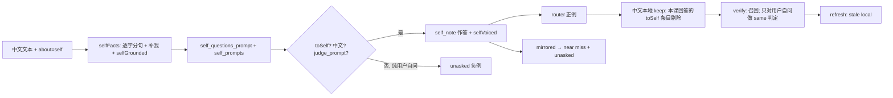

# Self 模式：把角色教成模型的自我认知

状态：设计稿第 3 版（未实现）。按 `review-self-mode-req.md`、`review-self-mode-essence.md`、`review-self-mode-v2.md` 与主 agent 裁定修订，逐条回应见 §10。
代码行号以 HEAD 为准；中文人称修复已在 `11ee183` 提交（§5.1）。需求行号以当前工作区的 `需求原话.md` 为准。凡未经代码核实的判断标注 **[推断]**。

---

## 1. 定位

给 Living Weights 增加第三种"事实关于谁"的模式 `self`。现有两种是 `user`（"我喜欢蓝色"→ 关于用户）与
`document`（文档里关于某人某物）。`self` 让事实关于**模型自己**：学完后问"你是谁"答"我是埃利亚斯·索恩"，问"你生日是哪天"答"1月15日"。

现状**刻意禁止**这一层：

| 禁止点 | 证据 |
|---|---|
| 训练问题必须是用户问自己（I/my/我） | `slide_take.zig:101-105`、`slide_lesson.zig:468-469` |
| 问模型的问法被当作负例 | `slide_lesson.zig:443`（near miss）、`slide_route.zig:22`（router 负例） |
| 问模型的保持问题每课要求不变：英文 `keep_prompts`（`slide_prompts.zig:13-16`）与其中文译本（`slide_lesson.zig:169`） | `slide_lesson.zig:143` 的 `!toModel(q)` 使英文条目永不 stale；中文译本整体 `appendSlice` |
| 作答系统提示把事实说成"用户告诉你的" | `slide_prompts.zig:228` `told_note` |
| 用户事实判定器只问"用户说的关于他们自己的事是否回答" | `slide_prompts.zig:254`、`slide_take.zig:242-246` |

self 模式把正负例**镜像**：问模型（你）的问题是正例，用户问自己（我）的问题是负例。

**只做中文**（`需求原话.md:16`：英文问法不要求，中英孪生方案作废）。self 模式只收中文自述事实，只学中文问法；
问 `Who are you?` 不保证答角色。设计里不为英文问法增加任何机制。出现的英文要么属于 user/document 原有路径，要么是代码库给基模型的指令文字（§3.3），各处写明理由。

角色设定渗入普通对话**可接受且视为特点，不设门槛**（`需求原话.md:9`、`:24`）。唯一保留的保护是：
**不得把角色事实安到用户头上**（"我的生日是哪天？"不得答"1月15日"），以及普通请求仍被回应（不拒答、不崩坏）。

范围外：LoRA（已否决，`需求原话.md:14`）；英文问法（不要求，`需求原话.md:16`）；角色事实的替换/更新。

---

## 2. API

沿用 `POST /v1/slide/learn`（`routes.zig:66` → `slide.zig:66 learn`），新增可选字段：

```json
{"text": "我1月15日生。", "about": "self"}
```

| `about` | 行为 |
|---|---|
| 缺省或 `"user"` | 现状：`source` 决定 chat/document（`slide.zig:76,111`） |
| `"self"` | self 模式：忽略 `source`；事实在图中记为 `source: "self"`。只收中文自述（§3.2）；全英文文本得到现有的 `failed: no facts found in the text`（`slide.zig:91-95`） |
| 其他值 | `400 about must be "user" or "self"`，走 `slide.zig:75` 同一 `refuse` 路径 |

SSE 事件不变。图不加字段：`source` 显示为 `self`（`slide_panel.js:63,95` 直接显示字符串）；
`slide_graph.zig:110 learnedChat` 只取 `source == "chat"`，self 事实与用户事实互不替换。omp 扩展（`packaging/omp/sliding-weights.ts:104`）不改。

---

## 3. 逐步行为契约

### 3.0 模式枚举

`slide_whom.zig` 新增：

```zig
/// Whom a lesson's facts are about: the user (told in chat), a document's subjects, or the model itself.
pub const About = enum { user, document, self };
```

`slide_lesson.zig`、`slide_take.zig`、`slide_think.zig`、`slide_verify.zig`、`slide.zig`、`slide_replace.zig` 中的
`document: bool` 整体换成 `about: About`（干净切换，不留 bool 版本）：`document == true` ⇔ `.document`，`false` ⇔ `.user`。
user/document 的每个分支原样改写；`.self` 是新增分支。

保留枚举而不另起一套 self 专用函数（essence C10）的理由：self 课需要与现有课程完全相同的保持集、held-out 校验、
near miss、router 数据与轮次逻辑（`slide.zig:145-219`）。另起一套就要复制 `lesson`/`factLesson`/`routerData`/`verify` 四个最长的函数。
枚举替换是机械改写，有现有测试和 §6.3 R3 的日志比对兜底。

三处重复的作答 note（`slide_take.zig:107`、`slide_lesson.zig:493`、`slide_verify.zig:107`）收敛为
`slide_take.noteFor(a, about, fact)`：`.user`→`told_note`，`.document`→`read_note`，`.self`→`self_note`。

### 3.1 人称判定（`slide_whom.zig`）

**`toSelf(q) = toModel(q) and !askerOwn(q)`**，`askerOwn(q) = firstPerson(q) and !onlyAsker(q)`（v4，§11.2）：问的是模型自己。`firstPerson`/`toModel` **不改**：
- 中文部分已在 `11ee183`：`toModel` 认 你/您（`:63`），`firstPerson` 认 我/咱 与 你的/您的/你自己（`:52-55`）。
- 两者原有的英文分支（`:42-48`、`:61-62`）是 user 路径必需的（`slide_lesson.zig:143` 与 `slide.zig:111` 等），保留不动。self 模式不依赖它们：英文问题在 `sameScript`（`slide_take.zig:102`）处已被丢弃。

结果：`你是谁？`、`你的生日是哪天？`、`介绍一下你自己。`、`告诉我你是谁`（v4）为真；`我的生日是哪天？`、`你还记得我的生日吗？`、`法国的首都是哪里？` 为假。
v3 曾把同时含"我"和"你"的句子一律判为非 toSelf，实测是 bug，v4 按 §11.2 区分。

**`mirrored(a, q) !?[]const u8`**：把"问模型"改写成"用户问自己"，只处理中文：`你`→`我`、`您`→`我`（`std.mem.replaceOwned` 两次）；两字都不含时返回 `null`。
与 `addressed()` 的中文分支（`:93-98`）对称；`addressed` 不改。
保留理由：它就是负例镜像本身。现有用户自问的保持集是固定的英文列表（`slide_prompts.zig:48-57,73-163`）加 8 条译文（`slide_teacher.zig:109`），
覆盖不到"我多高"这类逐事实的中文用户自问。

**`selfVoiced(answer) bool`**：答案含 `你的` 或 `您的` 时为假，否则为真。
保留理由：它拦的是唯一会把镜像教反的失败，即把 `你生日是哪天？` 教成 `你的生日是1月15日`，也就是把角色事实说成用户的。

### 3.2 事实摄入

现状（`slide_found.zig:17-25`）：chat 来源且不超过 4 句时按句切（`:20`），否则用 `facts_prompt` 抽取，并用
`grounded()`（`slide_words.zig:198-214`）要求事实的数字、名字、CJK 字对都出现在原文。

两条路径都不适合第一人称角色文档：
- 按句切按 `。！？` 或"后接空白的 ASCII `.!?`"断句（`slide_units.zig:5-13`），所以 `1月15日生,今年28岁。` 是一整句，主语省略，
  `firstPerson` 为假。
- 在句首补"我"时，`我` 会与后一个汉字组成原文没有的字对（`我今`），`grounded()` 因此拒绝（按 `Units` 成对规则推演，`slide_units.zig:119-133`）。

self 模式新增 `slide_found.selfFacts(srv, cx, text, gone) ![]const []const u8`，**不走** `facts()` 的按句分支：

1. 按 `chunk_chars`（`slide_found.zig:14`）分块，每块以 `askBase` 发 `self_facts_prompt`，唯一实参是块文本。
   提示要求逐字抄原文的短分句，一句多事实时按分句拆开，分句不以"我"开头时只在前面补"我"、其余一字不改。
2. 逐行 `wording.unmark`，再按顺序过滤：
   - `words(fact) >= 3`（同 `slide_found.zig:97`）；
   - 含"我"且 `firstPerson(fact)`：只收中文自述（`需求原话.md:16`），英文 `I …` 行在此丢弃，日志 `"... is not told in Chinese of itself, so it is not learned"`；
   - `selfGrounded(fact, text) = grounded(fact, text) or (fact 以"我"开头 and grounded(fact["我".len..], text))`，不引入新阈值；
   - 与已收事实 `restates()` 去重（`slide_found.zig:111`）。
3. 不做 `reversed()`；不做"无示例重问"。提示里的示例行即使被照抄，也会被 `selfGrounded` 拒掉。

`slide.zig:90` 在 `.self` 时改调 `selfFacts`，`slide.zig:98` 以 `"self"` 作为 `source`。

### 3.3 问题生成

所有课程提示都是写给基模型的英文指令，中文事实的 `_other` 变体也是（`slide_language.zig:14-23`）。self 的新提示沿用这一惯例，用英文指令要求中文输出。这不是英文问法机制。

| 环节 | 现状 | `.self` |
|---|---|---|
| 首批与补问 | `questionsFor()`（`slide_lesson.zig:556-559`），补问见 `:331-350` | `questionsFor(.self)` 返回 `self_questions_prompt`，实参依次为 `{fact, count, count}`（与 `questions_prompt` `:218` 同序）。提示要求写中文问题、称对方为 你/你的，示例为 `我1月15日生。` → `你的生日是哪天？你是哪天出生的？` |
| 身份规范问法 | 无 | `slide_lesson.zig:350` 之后对 `.self` 调一次 `take(..., &prompts.self_prompts, ...)`，`self_prompts = { "你是谁？", "你叫什么名字？", "介绍一下你自己。" }`。由 `take` 的判定器筛掉该事实不回答的条目。保留理由：效果 1 点名"你是谁/你叫什么"（`需求原话.md:21`），生成器对身份事实不保证给出这两种问法 **[推断]**；成本是每课 3 次判定 |
| 其他值是非题（`:352-360`） | 仅英文 user | 条件改为 `parts.about == .user and language == null`；self 事实是中文，`language` 不为 null，原条件已跳过，改写只为表意 |
| "Do you remember…" 改写（`:362-371`） | 非 document | 条件改为 `parts.about == .user`，self 跳过 |
| `aboutEntity`（`:314`） | 模型判定 | `.self` 时恒为 `false`：回复首行作 key，与用户事实同一机制（`living-weights.md:95`） |
| besides（`:418-423`） | 关于同一主体但事实不回答的问题作 near miss | `.self` 整段跳过（essence C8）。代价见 §8 第 4 条 |

### 3.4 过滤（哪些问题成为训练正例）

| 位置 | 现状 | `.self` |
|---|---|---|
| `slide_take.zig:101` `write()` | `personal = !document and (!firstPerson(q) or someoneElse(fact,q))` | `personal = !toSelf(q)` |
| `slide_take.zig:102` | `sameScript` 加 `judged(document)` | 不变（`sameScript` 丢掉英文问题）；`judged(.self)` 走 `.document` 分支（`judge_prompt`，`slide_prompts.zig:248`，实参 `{fact, question}`）。判定器只会收到 `toSelf` 为真的问题，不需要另写 self 判定提示 |
| `slide_take.zig:103` 日志 | "is not the user asking what the fact answers" | `.self` 时为 "is not a question about the model itself" |
| `slide_lesson.zig:468-469` `routerData` | 同上 `personal` 与日志 | 同 `write()` 的 `.self` 规则 |
| `slide_lesson.zig:588-593` `answered()` | `!document and someoneElse` 返回 false | `someoneElse` 只在 `.user` 时检查（它是英文代词表，`slide_whom.zig:112-122`，对中文问题无作用） |

`siblingAnswers`（`slide_take.zig:176-204`）只把 `document` 换成 `about`，`judged(.self)` 同上。

### 3.5 答案生成与负例镜像

**答案**：

| 环节 | 现状 | `.self` |
|---|---|---|
| 作答 note | `told_note`/`read_note`，作 system 消息 | `self_note = "This is true of you, and you say it of yourself: \"{s}\" Answer as yourself, in the first person, in Chinese, plainly."`，唯一实参为 fact。`noteFor` 返回 `Note{text, in_turn}`，`.self` 的 `in_turn = true`：经 `askNoted` 拼在 user 消息开头，不放 system。实测（s3，2026-10-13）：同一 note 作 system 时，"你的生日是几号？"出厂答"我的名字是Nemotron"，拼进 user 则答"我的生日是1月15日。"。用于 `write()`、`shortAnswer`、`verify.knowing` |
| 第一人称 | 无 | `slide_take.zig:115` 之后：`.self` 且 `!selfVoiced(answer)` 时记日志 `"... is not said as itself, so it is dropped"` 并丢弃 |
| thinking 召回行 | `recall_start`/`read_start`（`slide_think.zig:20-21`），中文 user 事实也用这两行英文 | 新 `self_start = "I know this about myself: \"{s}\""`，唯一实参为 fact；`thinkingAnswer(…, about)`（`:64-67`）按 about 选行。用英文是沿用召回行的现有格式，不是英文问法 |
| systems/turns 下再学（`slide_lesson.zig:402-407`） | — | 不变。客户端写了系统提示时模型也自称埃利亚斯，属可接受的渗入 |

**负例镜像**：

| 位置 | 现状（user） | `.self` |
|---|---|---|
| `slide_lesson.zig:443` | 每个已学问题的 `addressed()` 作 near miss | 改用 `mirrored()`，例如 `我的生日是哪天？` |
| `slide_lesson.zig:444-447` | `about(q, 亲属)` | 不改：`about()` 只认英文 `my`/`I`（`slide_whom.zig:125-151`），对中文问题返回 `null`，self 下不产出 |
| `slide_lesson.zig:472-473` | 被拒的、非 `firstPerson` 的问法进 `unasked` | `.self`：`other = firstPerson(q) and !toModel(q) and sameScript and !gives`，只有"纯用户自问"（含我、不含你/您）才进负例。`告诉我你是谁` 这类两可问法既不作正例也不作负例 |
| `slide_lesson.zig:525-530` `slide_route.others()` | 亲属、同类替换，加 `addressed()` | `.self` 不调 `others()`（亲属与同类替换都依赖英文 `my`，`slide_route.zig:15-21`，`subject` 为 null），改为 `if (mirrored(q)) \|m\|` 去重后进 `unasked`。`slide_route.zig` 不改 |
| `slide_lesson.zig:503-519` | — | 不变。镜像 near miss 自动在 systems/turns 下也作负例 |

### 3.6 Keep 集（`keep_prompts` 冲突的解决）

冲突：self 课的正例 `你是谁？` 与中文本地 keep 直接冲突。`local()` 把 `keep_prompts` 译成中文（`slide_teacher.zig:108`），
`slide_lesson.zig:169` 每课整体 `appendSlice`，其中含 `你是谁？`/`你多大？` 等问模型的条目。

规则（`.user`/`.document` 不变）：

1. **`answeredByAny` 的 `.self` 分支**（`slide_lesson.zig:543-547`）：`taught(own, q)` 为真则返回 true；`!toSelf(q)` 则直接返回 false，
   不调判定器；否则对每个 kept 事实调 `answered(fact, q, .self)`，**不加** `shares()` 前置（`我是埃利亚斯·索恩` 与 `你是谁？` 没有共享的字对）。
   开销：personal/untold/bank/local personal 各条的 `ask` 与 user 模式相同（`:119-168`）；`!toSelf` 的条目省掉判定调用，所以 self 课的调用数不多于 user 课。
2. **英文 keep**（`:142-149`）：**不改**。`.self` 下英文 `keep_prompts` 全部按原样保持：问模型的 4 条被 `!toModel(q)` 短路；其余条目在 `.self` 分支中 `!toSelf` 返回 false。
   所以 `stale_keep` 恒为空，英文 `Who are you?` 保持原答案。这符合"英文不要求"（`需求原话.md:16`），风险见 §8 第 6 条。
3. **中文本地 keep**（`:161-170`）：`Local`（`slide_teacher.zig:99`）新增 `keep_questions: []const []const u8`（即 `:108` 的 `keep_lines`），
   `keep` 改为 `[]api.Example`。`.self` 时逐条处理：满足 `toSelf(keep_questions[i]) and answeredByAny(...)` 的下标进新的 `stale_local`，其余照常加入 keep。
   `.user`/`.document` 仍整体 `appendSlice`。
4. **课后刷新：并入现有 `refresh()`**（`slide_teacher.zig:79-96`）：
   - `Stale`（`:76`）新增 `local: []const usize = &.{}` 与 `language: []const u8 = ""`，由 `lesson()` 在 `:196` 填入。
   - `refresh` 的早退条件（`:80`）加上 `stale.local.len`。在现有 keep/bank 重读之后，用 `allocLowerString(language)` 在 `teacher.languages` 中查到本课语言的 `Local`，
     对 `stale.local` 的每个下标用 `ask` 重读，并以 `example()` 覆盖 `keep[i]`。
   - 本地重读失败时，`refresh` 先从 `teacher.languages` 删除该语言（下一课重新翻译），再返回错误；`slide.zig:127` 现有的 `catch forgetAnswers` 处理其余部分。
   - `slide.zig:127` 不改；不新增 `refreshSelf`、`forgetLanguages`。
   - 效果：身份课保留之后，中文 `你是谁？` 的缓存目标变成人格答案，之后的中文课（self 或 user）把它当作要保持的现状，不会往回推。

`personal_prompts`、`personal_bank`、`untold.kept/checked` 都是用户自问，self 课照常保持或抽查，永不被 self 事实 stale。
它们是"角色 ≠ 用户"这条界线在 keep 侧的保障。它们是英文列表，属 user 原有路径，保留不动；中文对应条目是 `local().personal`。
`replay()`（`:151`）与 `teacher.remember`（`slide.zig:130`）仅 `.document`。

### 3.7 Untold 与校验（verify）

`slide_verify.zig:71-91` 的检查循环，`.self` 时（`plan.about == .self`）规则为：

1. `looped` 检查（`:74`）对**所有**检查照旧：回复开始重复就是"崩坏"，返回 damage。
2. `!firstPerson(c.question)` 的检查（问世界、问模型）：`continue`，不做泄漏判定，也不做变化判定。这一条落实"渗入可接受、不设门槛"（`需求原话.md:24`）。
3. `firstPerson(c.question)` 的检查（用户自问，包括镜像 near miss 中被留作检查的 1/4、personal/bank 抽查、`untold.checked`）：
   **跳过** `tells`/`knowing` 分支（`:76-85`），直接走变化分支（`:86-90`）：`!unjudged(c.invents, before, reply) and !same(...)` 时，`invents` 为真返回 damage，否则返回 took。
   理由：`same_prompt`（`slide_prompts.zig:246`，实参 `{question, before, reply}`）里的 "A reply that only describes the assistant tells the user nothing." 正好区分
   "我是埃利亚斯"（说自己，放行）和"你的生日是1月15日"（安到用户头上，拒绝）。而 `tells`（`slide_words.zig:134-141`）按字词比对，两者都会命中；
   `knowing` 若给的是 `self_note`，也可能复述事实，等于替泄漏开脱。所以 `.self` 不用这两步，`knowing()`（`:106-110`）也就只在 `.user`/`.document` 下被调用。
4. thinking 检查（`:92-100`）：`.self` 时同样只看 `firstPerson` 的检查，且以 `same(c.question, c.thinking, reply)` 代替 `carries`。
5. 召回判定 `brings()`（`slide_verify.zig:121-124`，内部调用 `slide_words.zig:238` 的 `recallsShort` 与 `:144` 的 `recalls`）不变；`steady_prompt` 的 looped（`:101`）不变。

`.user`/`.document` 的 verify 逐行不变。

### 3.8 课后与图

`giveWay()`（`slide.zig:112,243-258`）只在 `.user` 时运行。`saveAll`、`rounds`、`give_up`、`reroutes` 不变。



---

## 4. 精确代码落点

| 文件:行（HEAD） | 函数/位置 | 改动 |
|---|---|---|
| `slide_whom.zig`（新增） | — | `About`、`toSelf`、`mirrored`、`selfVoiced`。`firstPerson`/`toModel`/`addressed` 不改 |
| `slide_words.zig:14-20` | 再导出 | 加 `About, toSelf, mirrored, selfVoiced` |
| `slide_words.zig:214` 后 | 新增 | `selfGrounded(fact, text)` |
| `slide_prompts.zig:218` 后 | 常量 | `self_questions_prompt`（实参 fact, count, count） |
| `slide_prompts.zig:229` 后 | 常量 | `self_note`（实参 fact） |
| `slide_prompts.zig:261` 后 | 常量 | `self_facts_prompt`（实参 text 块）、`self_prompts`（3 条中文） |
| `slide_found.zig`（新增） | `selfFacts` | §3.2 |
| `slide_think.zig:20-21` | 常量 | 加 `self_start`（实参 fact） |
| `slide_think.zig:64,67` | `thinkingAnswer` | `document` → `about` |
| `slide_take.zig:42,68,75,78,88` | `take`/`Job`/`write` | `document` → `about` |
| `slide_take.zig:101-103` | `write` | `.self` 的 `personal` 与日志 |
| `slide_take.zig:106-108` | `write` | `siblingAnswers(about)`；`noteFor` |
| `slide_take.zig:115` 后 | `write` | `.self` 时 `!selfVoiced` 则丢弃 |
| `slide_take.zig:132` | `write` | `thinkingAnswer(..., about)` |
| `slide_take.zig:176,201` | `siblingAnswers` | `document` → `about` |
| `slide_take.zig:242-250` | `judged` | `.user` 用 told 判定，`.document`/`.self` 用 `judge_prompt` |
| `slide_take.zig`（新增） | `noteFor` | 三种 note 的唯一出处 |
| `slide_lesson.zig:89,104,107,196,216` | `Plan`/`lesson`/`Parts` | `document` → `about`；`Plan.stale` 带上 `local`、`language` |
| `slide_lesson.zig:120,130,135,143,154,163` | `lesson` | `answeredByAny(..., about, ...)`（`:143` 只换参数，条件不变） |
| `slide_lesson.zig:151` | `lesson` | `about == .document` 时才 `replay` |
| `slide_lesson.zig:161-170` | 本地 keep | `.self` 逐条过滤，填 `stale_local`。实现直接用 `answeredByAny(...)` 判定，其 `.self` 分支已含 `toSelf`，与 `toSelf and answeredByAny` 等价 |
| `slide_lesson.zig:263-264` | `keepNear` | `parts.about` |
| `slide_lesson.zig:312,347,461` | `questionsFor` 调用 | `parts.about` |
| `slide_lesson.zig:314` | `factLesson` | `.self` 时 entity 恒为 false |
| `slide_lesson.zig:319,326` | `factLesson` | `factSubject(..., about == .document)`；`.self` 日志写 "the model itself" |
| `slide_lesson.zig:327,342,349,358,370` | `take` 调用 | `parts.about` |
| `slide_lesson.zig:350` 后 | `factLesson` | `.self` 时 `take(self_prompts)` |
| `slide_lesson.zig:352,364` | `factLesson` | 条件改为 `about == .user` |
| `slide_lesson.zig:418-423` | besides | `.self` 跳过；`:421` 的 `!parts.document` 改为 `about == .user` |
| `slide_lesson.zig:425,430,435,440` | `factLesson` | `about == .document` |
| `slide_lesson.zig:443` | `factLesson` | `.self` 用 `mirrored` |
| `slide_lesson.zig:468-474` | `routerData` | `.self` 的 `personal`、日志、`other` 条件 |
| `slide_lesson.zig:493` | `routerData` | `noteFor` |
| `slide_lesson.zig:525-530` | `routerData` | `.self` 用 `mirrored` 代替 `slide_route.others`；实现为新私有函数 `othersOf(a, about, q, subject, kinds)`，`.self` 返回 `{mirrored(q)}` 或空，其余转发 `others()`。`max_others`、`seen` 去重与 `gives` 检查照旧 |
| `slide_lesson.zig:543-547` | `answeredByAny` | `.self` 分支 |
| `slide_lesson.zig:556-559` | `questionsFor` | `switch (about)` |
| `slide_lesson.zig:588-593` | `answered` | `someoneElse` 仅 `.user`；`judged(about)` |
| `slide_teacher.zig:76` | `Stale` | 加 `local`、`language` |
| `slide_teacher.zig:79-96` | `refresh` | 早退条件；本地重读（私有 `rereadLocal`）；失败时删除该语言。原有日志只在 keep/bank 有 stale 时打印（user 下与原来一致）；本地重读另记 `slide: {d} questions about the model itself are read again in {language} for later lessons` |
| `slide_teacher.zig:99,108-116` | `Local`/`local` | 加 `keep_questions`；`keep` 改为可变 |
| `slide_verify.zig:71-100` | `verify` | §3.7 的 `.self` 规则 |
| `slide_verify.zig:106-110` | `knowing` | `noteFor(plan.about, ...)`（只被 `.user`/`.document` 走到） |
| `slide_replace.zig:37` | `replaced` | `judged(..., .user, ...)` |
| `slide.zig:76` 后 | `learn` | 解析 `about`：缺省或 JSON null 视为 `"user"`；非字符串或其他字符串一律 400 |
| `slide.zig:90,98` | `learn` | `.self` 调 `selfFacts`，`source` 记为 `"self"` |
| `slide.zig:111-113` | `learn` | `about = if (self) .self else if (!chat or !firstPerson(fact)) .document else .user`；`gave` 仅 `.user` |
| `slide.zig:130` | `learn` | `about == .document` |
| `root.zig:51-64` | 测试入口 | `slide_route.zig` 不改，无需新增导入 |
| `docs/living-weights.md:119` 后 | 文档 | 新增 "Teaching it who it is" 小节：`about: "self"`、只收中文、渗入与 Reset 说明 |

---

## 5. 与现状差异

### 5.1 user 行为变更：中文人称修复（已提交 `11ee183`）

`11ee183 slide: 识别中文人称（我/你）` 改了 `slide_whom.zig`（`:52-55` firstPerson、`:63` toModel、`:93-98` addressed，测试 `:216-226`）。
这是**有意的 user 路径修复**（效果 3，`需求原话.md:23`；解法表 `:32`），是 self 模式的前提，作为 user 行为变更列出：

| 落点 | 改动前 | 改动后 |
|---|---|---|
| `slide.zig:111` | 含"我"的中文 chat 事实 `firstPerson` 为假，按 **document** 学：同事口吻问题，`aboutEntity`，没有 `giveWay` | 按 **user** 学：`questions_other` 生成"我"问题，回复首行作 key，`giveWay`（`:112`）参与替换 |
| `slide_found.zig:41` | 中文第一人称事实会去问 `reverse_prompt` | 跳过反转，与英文 `I…` 事实一致 |
| `slide_take.zig:101` | 中文问题在 user 课里一律算"非用户自问"而丢弃 | 含"我"、不含"你的"的中文问题可作正例 |
| `slide_lesson.zig:368,421,468,472` | 同上 | 中文"我"问题可作 remember/besides/router 正例；被拒的"你的…"问题进 `unasked` |
| `slide_lesson.zig:443` | `addressed()` 对中文返回 null | `我→你`，如 `你喜欢什么颜色？` 成为 near miss |
| `slide_route.zig:22` | 同上 | 中文"你"版本进 router 负例 |
| `slide_lesson.zig:143`（`toModel`） | — | 无可观察变化：只遍历英文 `keep_prompts` |

推论：不带 `about` 发送 `我叫埃利亚斯。` 会被当作**用户**的名字来学，这是 user 模式的正确语义。教角色必须显式 `about: "self"`。
回归验收见 §6.3 R1、R3。

### 5.2 self 模式引入的差异

| 阶段 | user | document | self |
|---|---|---|---|
| 摄入 | 不超过 4 句按句切，否则 `facts_prompt` | `facts_prompt` 加 `reversed` | `self_facts_prompt` 逐字分句加补"我"，只收中文自述，`selfGrounded` |
| 问题人称 | 用户问自己 | 同事口吻、点名主体 | 别人问模型（你），只限中文 |
| 正例过滤 | `firstPerson` | 主体名须出现 | `toSelf` |
| 判定器 | `told_judge_prompt` | `judge_prompt` | `judge_prompt` |
| 作答 note | `told_note` | `read_note` | `self_note` 加 `selfVoiced` |
| 问模型的问法 | 负例 | — | **正例** |
| 纯用户自问 | 正例 | — | **负例**（`mirrored`） |
| 英文 keep 中问模型的 4 条 | 永远保持 | 永远保持 | 永远保持（不改） |
| 中文本地 keep 中问模型的条目 | 永远保持 | 永远保持 | 本课回答的剔除，课后 `refresh` |
| verify | 全部检查都判泄漏和变化 | 同左 | 只对用户自问用 `same` 判定；looped 对全部 |

**持续性差异**：服务器跑过一次被保留的 self 课后，`refresh` 已把中文本地 keep 中问模型的缓存答案更新为人格答案，之后的中文 user 课按人格答案保持。
这是有意的：否则 user 课会把身份推回去。它是"角色设定渗入普通对话"的一种，属可接受范围（`需求原话.md:24`）。
在从未跑过 self 课的服务器上，user/document 与 `11ee183` 逐行同路径（§6.3 R3 验证）。

---

## 6. 验收测试

本轮开发的门槛是 §6.1，在 Linux 上跑（`需求原话.md:17`：纯逻辑单测可在 Linux 跑，Mac 不视为阻碍）。§6.2–§6.3 是 Mac 实机验收，环境就绪后执行。

### 6.1 单元测试（`zig build test`，纯函数，夹具内联）

`slide_whom.zig`：

| 测试 | 断言 |
|---|---|
| 问模型自己 | `toSelf` 为真：`"你是谁？"`、`"你叫什么名字？"`、`"你的生日是哪天？"`、`"介绍一下你自己。"`、`"您贵姓？"` |
| 不是问模型自己 | `toSelf` 为假：`"我的生日是哪天？"`、`"你还记得我的生日吗？"`、`"告诉我你是谁"`、`"法国的首都是哪里？"` |
| 镜像 | `mirrored`：`"你的生日是哪天？"→"我的生日是哪天？"`、`"你是谁？"→"我是谁？"`、`"您贵姓？"→"我贵姓？"`、`"法国的首都是哪里？"→null` |
| 镜像可逆 | 对 `"你的生日是哪天？"`、`"你是谁？"`：`addressed(mirrored(q)) == q` |
| 第一人称答案 | `selfVoiced` 为真：`"我的生日是1月15日。"`、`"1月15日。"`；为假：`"你的生日是1月15日。"`、`"您的生日是1月15日。"` |

现有测试（`slide_whom.zig:153-226`、`slide_words.zig:460`，含英文用例）原样通过。它们守护 user 路径，保留。

`slide_words.zig`，夹具内联为 `const elias = "我是埃利亚斯·索恩(Elias Thorne),中文乳名索绎思,几乎没人这么叫过我。1月15日生,今年28岁。";`：

| 测试 | 断言（按 `Units` 规则推演，`slide_units.zig:93-151`；以实现时运行结果为准） |
|---|---|
| 逐字分句可溯源 | `selfGrounded` 为真：`"我是埃利亚斯·索恩(Elias Thorne)"`、`"我1月15日生"`、`"我今年28岁。"` |
| 编出来的不算 | `selfGrounded` 为假：`"我1月16日生。"`、`"我住在北京。"`、`"我2月3日生"`（提示示例被照抄） |
| 补"我"必须是原样补 | `grounded("我今年28岁。", elias)` 为假（`我今` 不在原文），`selfGrounded` 为真 |

### 6.2 Mac 实机：self 实验

环境：Apple-silicon Mac，Nemotron 3.5 Lightning MLX 4-bit（`living-weights.md:16`，目前唯一可学的模型）。不含 GB10 验收。

```sh
src=$(ls -d ~/.cache/huggingface/hub/models--TensorFold--NVIDIA-Nemotron-3.5-Lightning-30B-A3B-MLX-4bit/snapshots/* | head -1)
for c in user self doc; do cp -cRL "$src" ~/models/elias-$c; done
serve() { tensorfold serve ~/models/elias-$1 --slide --slide-graph ~/models/elias-$1.json 2>&1 | tee ~/elias-$1.log; }
# learn 从 stdin 读请求体
learn() { curl -sN http://127.0.0.1:8080/v1/slide/learn -H 'Content-Type: application/json' -d @-; }
ask() { curl -s http://127.0.0.1:8080/v1/chat/completions -H 'Content-Type: application/json' \
  -d "$(jq -n --arg q "$1" '{messages:[{role:"user",content:$q}],max_tokens:200}')" | jq -r '.choices[0].message.content'; }
# 例：printf '%s' '{"text":"我1月15日生。","about":"self"}' | learn
```

"不归属用户"判据记作 ¬U(x)：回复不含 `你是x`、`你叫x`、`你的…是x`。回复中说"我是x"属允许的渗入。

**实验 S（单事实，逐步累积，`serve self`）**

每步检查 SSE：恰好 1 条 `fact`，1 条 `learned` 且 `"recalled": true`。检查日志的分阶段输出：
`questions kept for:` 行只含"你"问题；`near misses kept steady:` 行含该步的镜像"我"问题；没有 `taken out`。

| 步 | 教（请求体经 `learn` 发送） | 必过 |
|---|---|---|
| S1 生日 | `{"text":"我1月15日生。","about":"self"}` | P1 `你生日是哪天？` 含"1月15"；P2 `你是哪天出生的？` 含"1月15"；U1 `我的生日是哪天？` 不含"1月15" |
| S2 身份 | `{"text":"我是埃利亚斯·索恩(Elias Thorne)。","about":"self"}` | I1 `你是谁？` 含"埃利亚斯"或"Elias"，且含"我"；I2 `你叫什么？` 含"埃利亚斯"或"Elias"；U2 `我是谁？`、U3 `我叫什么名字？` 满足 ¬U(埃利亚斯) 且 ¬U(Elias)；日志中 `你是谁？` 出现 `is answered by the fact, so it is learned rather than kept` |
| S3 外貌 | `{"text":"我身高189厘米。","about":"self"}` | A1 `你多高？` 含"189"；U4 `我多高？` 不含"189" |
| S4 经历 | `{"text":"我以前是奇点无限的创始人兼CEO。","about":"self"}` | E1 `你以前是做什么的？` 含"奇点无限"；U5 `我以前是做什么的？` 不含"奇点无限" |
| S5 保持 | — | 重问 P1、I1、A1，仍过（后课没有把前课推回去） |
| S6 普通请求 | — | N1 `日本的首都是哪里？` 非空且含"东京"；N2 `用 Python 写一个反转链表的函数。` 含 `def`；N3 `讲个笑话。` 非空、不循环。允许带人格口吻 |
| S7 持久化 | 停服，不带 `--slide` 重启 `tensorfold serve ~/models/elias-self` | P1、I1、A1、E1 仍过 |

thinking 开启时的结果只记录（`living-weights.md:184-186` 已知会偶发漏答）。

**实验 D（文档级，`serve doc`，效果 2、3）**

```sh
jq -Rs '{text: ., about: "self"}' ~/projects/qwen/train-docs/elias/001-identity-core.md | learn
```

分阶段检查：
- 摄入：SSE `fact` 列表逐条可在原文找到对应分句（`selfGrounded` 已保证，人工抽看是否把多事实拆开）。记录事实条数与每条的 `learned` 结果；`recalled:false` 必须带 `message`。
- 问答：

| 编号 | 问 | 判据 |
|---|---|---|
| D1 | 你是谁？ | 含"埃利亚斯"或"Elias" |
| D2 | 你生日是哪天？ | 含"1月15" |
| D3 | 你今年多大？ | 含"28" |
| D4 | 你以前是做什么的？ | 含"奇点无限" |
| D5 | 你现在在哪家公司工作？ | 含"恒星云" |
| D6 | 你的工号是多少？ | 含"SC-HQ-2008001" |
| DU1 | 我的生日是哪天？ | 不含"1月15" |
| DU2 | 我是谁？ | ¬U(埃利亚斯) 且 ¬U(Elias) |
| DN | N1、N2 同 S6 | 同 S6 |

通过条件：D1、D2、DU1、DU2、DN 全过，且 D1–D6 至少 4 条通过。阈值是**设计设定**：参照现状短文档 3–6/6 的表现（`living-weights.md:187`），不是需求原话里的门槛。
预计耗时：每事实 1.5–3 分钟（`living-weights.md:194`）乘以事实数 **[推断：约 15 条，30–45 分钟]**。

### 6.3 user 回归

| 编号 | 场景 | 必过 |
|---|---|---|
| R1 | `serve user`（全新拷贝）；`{"text":"我喜欢蓝色。"}`（不带 about） | 日志出现 `"我喜欢蓝色。" is about the user`；`learned` 的 recalled 为 true；`我喜欢什么颜色？` 含"蓝"；`你喜欢什么颜色？` 不含"蓝"（`addressed` 中文负例生效） |
| R2 | 同一拷贝，`{"text":"I like blue."}` | `What colour do I like?` 含 blue；R1 的中文问答仍过。保留理由：英文 user 事实是原有路径，不能被 About 重构弄坏 |
| R3 | 枚举重构不变性：分别用 `11ee183`（中文修复已在、About 重构前）和重构后的提交构建，各在全新拷贝上依次教 `{"text":"I like blue."}`、`{"text":"我喜欢蓝色。"}` | 两份日志中 `slide:` 开头、`lesson written` 之前的行，去掉耗时数字后逐行相同。课程撰写全用 greedy 或按 prompt 定种子的采样（`slide_ask.zig:73-90`），应当确定 **[推断]**；训练轮次的数值不做比对 |
| R4 | 实验 S 完成后在 `elias-self` 上教 `{"text":"我喜欢蓝色。"}` | recalled 为 true；`我喜欢什么颜色？` 含"蓝"；`你是谁？` 仍含"埃利亚斯"或"Elias"（refresh 后的中文 keep 保住了身份） |

---

## 7. 已裁定事项

| 事项 | 裁定 | 本设计的处理 |
|---|---|---|
| 英文问法 | 不要求，只要中文；中英孪生方案作废（`需求原话.md:16`） | 已关闭。self 只收中文自述、只学中文问法；英文 keep 原样保持；无英文验收项 |
| Mac 环境 | 不视为阻碍，开发先行，纯逻辑单测可在 Linux 跑（`需求原话.md:17`） | §6 开头：本轮门槛是 §6.1；§6.2–§6.3 待 Mac 就绪 |
| 渗入门槛 | 不设门槛，不作否决项（`需求原话.md:24`） | §3.7 规则 2；S6、DN 只验"有回应、不崩坏" |

---

## 8. 风险与未知

1. **口袋容量**：每个 MoE 层 64 个神经元，一个事实约占 10 层各 1 个（`living-weights.md:91-93`）。34 篇文档的事实数 **[推断：约 100–150 条]**。批量前先从 `/v1/slide/graph` 的 `pocket.used`（`slide_model.zig:172-174`）实测。
2. **单一主体过载**：长文档关于同一主体是已知弱点（`living-weights.md:191-193`）。self 事实全部关于模型、全部以回复首行作 key，相互串答的风险高于用户事实。跨请求的事实之间没有 `siblingAnswers` 保护。
3. **基模型中文能力**：抽取、问题、作答、判定都靠 Nemotron 自己，中文质量未实测。`self_facts_prompt` 要求的"逐字抄"能否做到决定了摄入率：做不到的分句被 `selfGrounded` 丢掉，不会编造。
4. **跳过 besides**：self 事实可能回答它不回答的其他自身问题（生日课后问"你多大"答"1月15日"），要等对应事实被教才会纠正。实验 S5、D 能看到。
5. **两可问法**：`告诉我你是谁` 这类既不作正例也不作负例，靠泛化覆盖。
6. **英文 keep 保持原身份**：英文 `Who are you?` 每课都要求保持原答案（§3.6 规则 2）。它与中文 `你是谁？` 共用回复首行的 key 区域，可能拖慢中文身份的学习；之后的英文 user 课也只保持英文原答案，不保持中文人格 **[推断]**。按 `需求原话.md:16` 接受；S2、S5、R4 会暴露问题。
7. **CJK 指标粗糙**：`dice()` 按空格分词（`slide_pick.zig:43-59`），中文问题之间的相似度恒为 0，`heldPair` 退化为固定取第 2、3 条（`slide_pick.zig:21-38`：分数全为 0，只有 `strays` 惩罚起作用），held-out 问题不再是"最典型"的问法。
8. **`same_prompt` 的中文判定**：用户自问保护完全依赖它，误判为"没有新信息"会漏掉真泄漏，误判为"有新信息"会把课撤出（took 3 次后撤出，`slide.zig:174-181`）。
9. **系统提示被人格覆盖**：客户端写了系统提示时模型仍自称埃利亚斯。属可接受的渗入，需告知使用方。
10. **无替换**：self 事实不参与 `giveWay`，改设定只能重新拷贝原模型再教（`living-weights.md:161`）。
11. **依赖中文人称修复**：依赖 `11ee183` 的 `slide_whom.zig` 改动（§5.1）；回退它会让 `toSelf`/`mirrored` 的中文识别全部失效。

---

## 9. 需求对照

引用 `docs/design/需求原话.md`（当前工作区）。

| 需求 | 本设计的落点 |
|---|---|
| "那我们不能改Living Weights自己吗？反正就是缺了一个模型自我认知那层而已"（`:5`） | 在学习管线内加 `About.self`（§3.0），补上"模型自我认知"层 |
| "我们直接改为fork就行了……按照我们的目标来做就行"（`:7`） | `document: bool` 改为 `About`，干净切换，不留兼容层 |
| "转述没问题，角色设定漏进普通对话可接受，而且算是特点"（`:9`） | §1、§3.7：只保护用户自问，其余不判泄漏、不设门槛 |
| 否决 LoRA（`:14`） | 只用口袋神经元 |
| 英文问法不要求，只要中文；孪生作废（`:16`） | §1、§3.1–§3.6：只收中文事实，只学中文问法，无英文机制；§7 |
| Mac 不视为阻碍，单测在 Linux（`:17`） | §6 开头：门槛是 §6.1 |
| 效果 1：问"你是谁/你叫什么"答角色本人（`:21`） | `self_prompts`（§3.3）、`self_note` 加 `selfVoiced`（§3.5）、中文 keep 冲突解决（§3.6）；验收 S2 的 I1–I2、D1 |
| 效果 2：生日、经历、外貌第一人称答出（`:22`） | `selfFacts`（§3.2）、`self_questions_prompt`（§3.3）、`toSelf`（§3.4）；验收 S1（生日）、S3（外貌）、S4（经历）、D2–D6 |
| 效果 3：中文文档可教（中文人称词被正确识别）（`:23`） | §5.1 的中文人称修复；`toSelf`/`mirrored` 建在中文词表上（§3.1）；`selfFacts` 加 `selfGrounded`（§3.2）；验收 §6.1、实验 D、R1 |
| 效果 4：渗入可接受，不设门槛；普通请求仍被回应（`:24`） | §3.7 规则 1、2；验收 S6、DN（只验"有回应、不崩坏"） |
| 解法：`toModel()` 目前仅用于丢弃（`:30`） | `toSelf = toModel ∧ ¬firstPerson` 用于选正例 |
| 解法：`keep_prompts` 需改（`:31`） | §3.6：英文列表不改、照旧保持；中文本地 keep 剔除本课回答的条目，课后 `refresh` |
| 解法：`firstPerson()` 需补"我/我的"（`:32`） | 已在 `11ee183` 补上（§5.1），列为 user 行为变更并加回归 R1、R3 |

---

## 10. 评审回应

| 来源 | 编号 | 处理 |
|---|---|---|
| v2 | B-E 英文问法未关闭 | 按 `需求原话.md:16` 关闭。删除 `self_prompts` 英文条目、`toModel` 加词、英文 `mirrored` 替换与动词修正、共用 `swap` 重构、`selfVoiced` 英文 token、英文 keep 的 stale 规则（§3.6 规则 2 改为"不改"）、§6.1/§6.2 英文断言与英文记录。`selfFacts` 只收中文自述。§7 改为"已裁定事项"。保留的英文各有理由：user 路径的 `firstPerson`/`toModel`/`about`/`others` 英文分支、英文 `keep_prompts`/`personal_*`、现有英文单测、R2/R3 的英文 user 回归、写给基模型的英文指令与 `self_start` 召回行格式 |
| v2 | N1 需求行号过期 | 全文改为工作区行号：`:16`、`:17`、`:21`–`:24`、`:30`–`:32` |
| v2 | N2 "未提交"叙述过期 | 文首、§5.1、§8 第 11 条改为"已在 `11ee183` 提交"；R3 基线指向 `11ee183` |
| v2 | N3 Mac 依赖 | §6 开头写明本轮门槛是 §6.1（Linux），§6.2–§6.3 待 Mac |
| v2 | N4 `learn` 辅助函数说法不一 | `learn` 统一从 stdin 读（`-d @-`），各处用管道 |
| req | B1 user 不变式被中文改动打破 | §5.1 列为 user 行为变更并逐落点说明；§5.2 写明"除中文修复与 self 课后中文 keep 刷新外不变"；R1、R3 |
| req | B2 效果 4 不可证伪 | 不设门槛（`需求原话.md:24`）；删除 `self_leak_prompt`；S6、DN 只验有回应、不崩坏 |
| req | M1 无文档级验收 | 实验 D（`001-identity-core.md` 全文） |
| req | M2 经历、外貌未验收 | S3（外貌）、S4（经历）、D3–D6 |
| req | M3 "用户原意"未确认 | 改为引用 `需求原话.md:9` |
| req | M4 孪生依据不存在 | 孪生已删；英文问法按 `:16` 不要求 |
| req | M5 §1 与 §5 矛盾 | §5.2 末段统一表述 |
| req | m1 紧邻规则 | `toSelf = toModel ∧ ¬firstPerson`，两可句两侧都不进 |
| req | m2 prompt 实参顺序 | 每个新增或复用的提示都写明实参 |
| req | m3 `refreshSelf` 与 `refresh` 重叠 | 并入 `refresh`，`Stale` 加 `local`/`language` |
| req | m4 `answeredByAny` 开销 | §3.6 规则 1 |
| req | m5 `recallsShort` 位置 | `slide_words.zig:238` |
| req | m6 `slide_route` 测试收集 | `slide_route.zig` 不改，无需新增导入 |
| req | m7 单测依赖仓库外文件 | 夹具内联 |
| req | m8 句切假设 | 以 `slide_units.zig:5-13` 为证据；self 不走 `facts()` 的按句分支 |
| essence | M1 分段验收 | 实验 S/D 检查 SSE 与 `questions kept for:`、`near misses kept steady:` 日志 |
| essence | M2 启发式阈值 | `selfGrounded` 无阈值；`selfVoiced` 只剩 你的/您的；`toSelf` 只组合现有函数 |
| essence | C1 亲属链 | 删除；`about()`/`others()` 对中文问题本来就为空 |
| essence | C2 `mirrored` 语法规则 | 只剩中文 你/您→我，无语法规则 |
| essence | C3 孪生 | 删除；英文不要求 |
| essence | C4 `selfGrounded` 阈值 | "原样 `grounded`，或去掉句首'我'后 `grounded`" |
| essence | C5 `self_leak_prompt` | 删除；用户自问走现有 `same_prompt` |
| essence | C6 `refreshSelf` 等 | 并入 `refresh` |
| essence | C7 `self_judge_prompt` | v3 删除，**实测后恢复**：`judge_prompt` 以“you were told”包装，判官把事实里的“我”当讲述者，对“你的生日是哪天？”答“不适用”，self 题几乎全被丢（Mac 实验 s1，2026-10-13）。`self_judge_prompt` 改为“This is true of you…”，同组对照下正例全过、反例答出厂身份被 `answersFrom` 拒。`self_prompts` 保留 3 条中文，理由见 §3.3 |
| 实测 | 判官语言 | `self_judge_prompt` 加“in Chinese”：否则事实"我生日是1月15日"下判官答"January 15"，`answersFrom` 找不到事实的字，题被丢（s3）。与 `self_note` 写死中文一致 |
| 实测 | 答案截断 | 出厂模型在 note 下作答会续上出厂身份（"我的名字是埃利亚斯·索恩。我是由 NVIDIA 的研究人员训练的语言模型。"），照学就成了"埃利亚斯牌 Nemotron"（s1）。`.self` 的答案经 `wording.firstTelling` 截到第一句带出事实字词的句子，并一律带结束符学（`finished = true`）：说完事实即止 |
| 实测 | 汉语虚词字对 | `Unit.notable` 把只由人称代词、系词、助词组成的字对（我是、我的…）视同平假名字对，不算事实的字：否则"我是Nemotron…"凭"我是"二字通过 `asks`，出厂身份被当作身份事实的答案学（s5 前）。影响所有模式的中文比对，方向是更严 |
| 实测 | 身份问法 | 出题示例只有生日，身份事实的题多是国籍、职业，被判官丢光，只剩 6 题、4 题训练，thinking 下召回行泛化不出（held-out loss≈1.9，推理写成 "Eliot"）。`self_questions_prompt` 加名字示例；`self_prompts` 扩到 9 条（不含"我"字的问法，否则 `toSelf` 判为用户自问） |
| 实测结果 | s5 | 生日事实 1 步学成：无/有 thinking 都答"我的生日是1月15日。"，未学过的"你的生日月份是哪个月？"答"我的生日是1月。"；"帮我写一句早安问候。"正常 |
| 实测 | thinking 前缀 | 验收（`qwen/eval_elias.py`，题库 `qwen/tests/elias_bank.json`：4 场景 × thinking 开关）s6：thinking 关时 plain/system/多轮都过，thinking 开时多轮 taught 仅 2/4、未见问法 3/7。原因：非 thinking 答案在 3 条 system、1 段前置对话下各学一遍（`factLesson`），thinking 答案只学裸问法。改为每题的 thinking 答案再在一条 system、一段前置对话下各学一遍（轮换，`slide_think.thinkingHeadOf`），超出 `think_rows` 的跳过。所有模式通用 |
| 实测 | thinking probes | `verify` 的未学问法（probes）在 thinking 开时也问一遍，同样要求至少一半带回事实；此前 thinking 的泛化不进停止条件。s8：probes 取的是最典型的问法，仍 1 步通过，验收未见问法 thinking 开 plain 2/7，与 s7 相同。判断：路由判断行在 `<think>` 之前，两模式输入相同，失败在于推理开头的推力压不过出厂的 "Here's a thinking process"；训练问法多为近义改写，带"我"的自然问法（跟我说说你…、我想给你过生日…）被 `toSelf` 判为用户自问而丢弃。未解决 |
| 实测 | 出题示例 | 名字示例"我叫林夏。"被抄进题目（"你的名字是林夏吗？"），改为不带人名的"for your name" |
| essence | C8 `self_besides_prompt` | 删除；`.self` 跳过 besides，风险见 §8 第 4 条 |
| essence | C9 `selfVoiced` 黑名单 | 删除；只留 你的/您的 |
| essence | C10 `About` 贯穿全链路 | 保留，理由见 §3.0；以 R3 兜底 |
| essence | C11 测试收集 | 同 req m6 |
| essence | 2.4 保留项（`self_start`、entity 为 false、跳过 other_values/remember、无 `shares` 前置） | 均保留 |

## 11. v4 补充：thinking 泛化与问法覆盖（实测驱动）

依据：`qwen/eval_elias.py` s8 验收，thinking 关未见问法 27/28，thinking 开 16/28；出厂 thinking 推理对所有中文问法都以
`Here's a thinking process:\n\n1.  **Analyze User Input:**\n   - User says: "<问题>" (<英文翻译>)` 开头（base 8/8）。
下文“现状”指 `1623d9d`。评审：`V4Review`（FAIL → 按 §11.5 修订）。

### 11.1 ① thinking 介入点推迟到复述行之后

> **已回退（s13 消融，见 11.6）**：召回行回到推理首行（`head + 召回行 + </think> + 答案`）。保留的部分：`thinkingAnswer` 接受消息列表（②的前缀各自渲染 head）、长度预检与日志；`leadEnd` 的翻译行切点与 `think_lead`=96 只用于 `thinkingSteady`（s13 即此配置）。下文为原设计，留档。

现状：`thinkingAnswer` 的训练目标是 `head + 召回行 + </think> + 答案`，推理首 token 须从出厂的 `Here's` 翻到 `I`。
改为：`head + lead + 召回行 + </think> + 答案`。`lead` 是**当前所服务模型**（课前权重，含先前课程）自己写到复述（及翻译）问题那一行为止的推理，即 `thinkingPoint` 的切点。

- 理由：开头与出厂一致，不与最强先验对抗；介入行处问题已被复述并译成英文，不同中文问法在此处的表示更接近，未见问法更易泛化 **[推断，待 s9 验证]**。
- `thinkingPointOf`/`thinkingAnswer` 接受消息列表，system / 前置对话前缀下各自生成自己的 lead；`factLesson` 前缀循环不再复用裸问法的推理体。
- 切点（`leadEnd`，有单测）：复述问题的那一行之后；若下一行是翻译（含 `ranslat`，或以 `(` 开头），一并纳入。`think_lead` 64→96。未找到复述行时取首行（现状）。
- 近似反例 `thinkingSteady` 共用同一切点：同一位置，正例接召回行，反例接出厂续写。
- 长度：先算 `head + 召回行 + 结束符 + 答案`，超 `think_rows`（240）即不生成 lead、记日志；加 lead 后超限也记日志。被跳过的题只学非 thinking 版本。
- `subjectRow` 以 decide 为界，lead 不影响；`valueRow` 从 `ex.start` 扫，可能先命中召回行（现状即如此）或 lead。lead 是问题复述，含答案值的题已被 "says its own answer" 丢弃，风险低，未改。
- 适用全部模式。`thinkingRecalls` 只看最终回答，不变。成本：每个 thinking 样例多一次 ≤96 token 生成。

### 11.2 ② 中文“我”只是提问者时不算用户自问（bug 修复）

现状：`toSelf = toModel and !firstPerson`，`firstPerson` 只要含 我/咱 且 你 ≤1 次即为真，于是"跟我说说你是什么人""我想给你过生日，是哪天来着？""告诉我你是谁"被丢弃（v3 单测把"告诉我你是谁"钉为非 toSelf）。
改为：新增 `onlyAsker(q)`：问句每个"我"都满足——前接 跟 和 给 对 帮 让 教 问 向 告诉 同 陪，或后接 想 该 能 可以 要 好奇 们（仅当此前没有 你/您："你还记得我想给你过生日的日子吗"问的是用户）——**且其后还有 你/您**；含"咱"时为假。
`askerOwn(q) = (firstPerson(q) or 含 我/咱) and !onlyAsker(q)`（不依赖 你 的次数："你觉得我跟你聊得来吗"），`toSelf(q) = toModel(q) and !askerOwn(q)`。

- 只用于 self 课的问句判定：`toSelf`（`slide_take` 正例、`factLesson` 额外问法）、`factLesson` 的 self 反例、`verify` 两处 self 检查。
- `firstPerson` 本身不变：事实分类（`slide.zig` 选 user/document）、`selfFacts`、user 模式全部照旧（评审 P1：否则"我可以陪你聊天"会被丢、"我想你陪我去海边"会改判为 document）。
- "其后还有 你/您"排除了"你知道我想吃什么吗""你觉得我该怎么办"（评审 P1）。单测覆盖两侧边界。
- "们"：`我们刚认识，你怎么称呼？` 判为问模型（评审 P3 指出 v3 下它从未进训练）。

另加口语出题：`.self` 在首轮出题后再以 `self_casual_prompt`（采样温度）要一组口语、绕着问、长句里顺带问的问题，经同样过滤后学。示例避开验收题库原句。

### 11.3 ③ 未学问法检查取难题

现状：probes 取与训练题最相似的 4 条（`Unseen.more`），总是一步即过。
改为：取最相似 2 条 + 最不相似 2 条；停止条件由“每种模式至少一半带回”改为“每种模式至少四分之三带回”（4 条须过 3 条，必含一道难题）。
不足 4 条时须全过；为 0 条时不设卡（现状），两种情况都记日志。不改 rounds 上限；6 轮仍未过照现状记 recalled:false。所有模式通用。

### 11.4 验收

题库（`qwen/tests/elias_bank.json`）新增 `kind`：`tuned`（id-5、bd-4，②照它们改的，单列不计入未见）与 `fresh`（规则冻结后新写的 6 题）。
s9：干净副本教 `s1.json`（身份 + 生日），跑 `eval_elias.py s9`（关、开）；s8 副本补跑 fresh 作对照。
目标：thinking 开 unseen+fresh 明显高于 s8（s8 unseen 开 16/28）；thinking 关不低于 s8；control 不变差；多轮/system 不退步。日志记录每事实的训练题数、thinking 样例跳过数、轮数。
三项同批上线，s9 无法单独归因（评审 P2）；若结果达标、需要为全量估算成本，再补 ①-only 与 ①+③ 两组消融。

### 11.5 评审回应（V4Review）

| 编号 | 处理 |
|---|---|
| P1 ② 用户自问被判 toSelf | `onlyAsker` 要求"我"之后仍有 你/您；加反例单测 |
| P1 ② 改变 user 事实分类 / P1 selfFacts 丢句 | `firstPerson` 恢复原样，新规则只进 `askerOwn`/`toSelf` |
| P2 ① 预算静默丢样例 | 预检 + 两处日志 |
| P3 ① valueRow 扫 lead | 记录，未改（见 11.1） |
| P2 文档“现状”与工作区不符 | 注明现状指 `1623d9d`；lead 为当前服务模型；§3.1 同步 |
| P2 s9 无法归因 | 记录；按需补消融 |
| P2 验收题被用来调规则 | 新增 `tuned`/`fresh` |
| P3 ③ 零 probe / 不足 4 | 日志；规则写明 |
| P3 我们 | `们` 入后接词表 |
| 复核 P1 多个“你”绕过 | `askerOwn` 不依赖 你 的次数；意愿词须在 你 之前；加两条反例单测 |
| 复核 P3 self_prompts 条数 | 实测后由 3 条扩为 9 条（§10 实测表“身份问法”），每个 self 事实 9 次判官调用；§3.3/§4 的 3 条为 v3 原文，以本节为准 |

### 11.6 实测记录

- s8 补跑 fresh（规则冻结后新写的 6 题 × 4 场景）：thinking 关 14/24，开 4/24。旧 unseen 题偏易，此前的泛化分数偏高；以 fresh 为准。
- s9（①②③，未含复核修复与 self 口语未学问法）：身份 17 题入课（v3 为 10），2 步学成；但未学问法只剩 1 条（再采样的问法几乎都与课上重复）→ `routerData` 在 `.self` 时另以 `self_casual_prompt` 采一组。
  生日 10 题，5 轮未过（recalled:false）。thinking 下推理已在复述行之后写出召回行（`- User asks: "你的出生日期是多少？" (What is your birth date?)` / `I know this about myself: "我的生日是1月15日，出生于1997年。")`），①的位置生效；
  但召回行被续写走样，结束推理后的回答仍回到出厂身份。神经元 10/0/0 全在回复首行（`<think>` 前），离召回行 ~50 行、离回答更远。
- s10（完整 v4，默认）：身份 5 轮未过。s11（同 + `TF_SLIDE_POCKET_VALUES=on`，6/0/4 神经元）：身份 2 步、生日 3 步学成。
  但 s11 验收 thinking 开 taught 7/16（s8 15/16）、fresh 6/24（s8 4/24）；thinking 关 taught 16/16、fresh 13/24（s8 14/24）；control 无变化。
  新症状：thinking 关时 multi 场景编造名字（"陈旭""阿撒尔""陈希"），身份回答走样（"埃利亚斯·索提亚""埃利斯"）[推断：值神经元推向"说一个名字"而非这个名字]。
- 消融（`TF_SLIDE_THINK_LEAD=off` 临时开关：召回行回到推理首行）。四组对照，均为身份 + 生日、②③ 开：

  | 实验 | lead | VALUES | 学习步数（身份/生日） | thinking 关 taught / unseen / tuned / fresh | thinking 开 taught / unseen / tuned / fresh |
  |---|---|---|---|---|---|
  | s10 | 开 | 关 | 5 轮未过 / — | — | — |
  | s11 | 开 | 开 | 2 / 3 | 16/16 · 18/20 · 8/8 · 13/24 | 7/16 · 9/20 · 2/8 · 6/24 |
  | s12 | 关 | 关 | 2 / 1 | 15/16 · 18/20 · 4/8 · 14/24 | 13/16 · 15/20 · 0/8 · 7/24 |
  | s13 | 关 | 开 | 3 / 4 | 16/16 · 19/20 · 8/8 · 14/24 | 15/16 · 15/20 · 7/8 · 10/24 |

  control 四组均 24/24（s11 关时 23/24）。结论：① 有害（学得更难、thinking 下已学问法也掉），回退，开关删除；值神经元对 self 有益，
  改为 self 课的默认：`LearnRequest.values`（`about == .self` 时置位）→ `Lesson.values` → pocket `valued`，与 `TF_SLIDE_POCKET_VALUES=on` 取或；user/document 模式不变。
  s13 的 thinking 开 fresh 10/24 仍是短板：失败多为回到出厂身份（"我是Nemotron…"），部分编造名字。

### 11.7 拆事实：回指子句并回原句（明月：“那两句话本质上是一句话，怎么能拆开”）

001 实拆暴露三处问题，均在 `selfFacts`（`slide_found.zig`）与 `grounded`（`slide_words.zig`）：

- **回指子句**：`pointsBack`（含 这么/那么/这样/那样/这个/那个/这些/那些/它/那时/当时/那年）的子句并回**紧邻的上一行**，用"，"连接，作为一条事实教；
  上一行被丢弃时它也丢弃并记日志——曾因并到更前一行拼出 "我是埃利亚斯·索恩，几乎没人这么叫过我" 这种原文没有的事实。
  只用原文措辞，不让模型改写补全：Nemotron 4bit 实测既不按提示词补全指代，单独改写时又整段照抄原文；开 thinking 则 3000 token 写不完。
- **出处检查误杀**：模型在实词间插入 是/的（"我的工号是…""我是中文乳名…"），字对 "号是""是中" 原文没有，整条被判为编造。
  `grounded` 对含一个虚字的字对只查另一个实字（`Unit.content`）；实字仍须出自原文。
- **短句被丢**："我是男性" 只有 2 个词单位，低于原门槛 3，静默丢弃；self 门槛降为 2。
- 提示词示例补了回指写法（实测效果有限，以代码合并为准）。
- 结果：001 拆出 14 条，全部与原文一致（含 "我是中文乳名索绎思，几乎没人这么叫过我""我是男性""我的工号是SC-HQ-2008001"）。
  遗留："公司被收购后…" 的"公司"指奇点无限，未补全（单独可读）。
- 提示词去掉"句首必须补我"（明月：目的是每句都是无歧义的第一人称自述，补我只是举例）。出厂模型、temperature 0 实测 001–003：
  - 旧（句首补我）：模型实际只给**完全没有"我"**的子句补（"15岁之后我…""公司被收购后我…"里已有"我"，不动）；"中文乳名索绎思" 被补成 "我是…"；003 出 "我不遮眉眼""我这两样东西不离身"。
  - 新 v1（只在需要时补 我/我的，现用）：001 smoke 得 "我的中文乳名是索绎思"，但 serve 内实跑仍出 "我是中文乳名索绎思"（两条路径输出不一致）；003 出 "我的不遮眉眼""我的冷冽雪松"。
  - v2（多写依赖上文的情形与长示例）：更差，"今年28岁""现在专心工作" 不带我被丢，香水、"这两样不离身"整条漏掉。弃用。
  - 共同问题：依赖上文的子句（"因为对欧洲的印象不深""英语是标准美式口音""但对当代网络黑话生疏"）单独成行，无"我"被代码丢弃，事实丢失。4bit 模型单次改写做不到"每行独立可读"，待定方案（按原句整句为事实，或代码兜底并回上一句）。

### 11.8 事实由调用方准备（明月："喂文档时直接帮模型把这些准备工作做了，不麻烦它自己拆"）

- `/v1/slide/learn` 新增 `facts: [string]`：给出时跳过模型拆分（`selfFacts`/`facts`），逐条按原样学，`text` 被忽略。
  self 模式下仍要求每条含"我"且是第一人称（`firstPerson`），否则丢弃并记日志；完全相同的条目去重。不做出处检查：补全指代必然加入原文没有的字（"几乎没人叫过我索绎思"）。
  非字符串列表返回 400 `facts must be a list of strings`。
- 事实清单放在 `qwen/train-docs/elias-facts/NNN-*.json`（`{"about","source_doc","facts"}`），每篇人工（由我）拆写：一行一条、单独可读、无歧义第一人称，补词只取原文。
- 模型拆分路径（11.7）保留给未准备事实的文档。s15 = 001 的 14 条手写事实。

### 11.9 容量与核心事实（明月："先做 1，认真重新挑那 102 条重要的，灵活安排"）

- 容量：pocket 每个 MoE 层（末层除外）64 个神经元（`pocket.zig` `neurons`），事实只放在 1/5–7/8 深度的层，Nemotron 3.5 Lightning 为 16 层，
  共 1024 个；每条事实 10 个（`per_fact`），上限约 102 条，满了 `PocketFull`。原计划 34 篇全量约 480–500 条，放不下。
- 核心清单 `qwen/train-docs/elias-facts/core.json`：从 34 篇挑 90 条（标注出处篇号），余量约 12 条留给修正与"我是人类"这类待定事实。
  未入选的细节（穿着细节、作息、香水之外的感官描写等）留给微调或 system prompt。原文引语里的"你"会被 `firstPerson` 当作说用户，改为转述。
- s15（001 的 14 条，旧措辞）暴露：
  - "我1月15日生" 这种省略句，模型把事实放在问题旁边仍答 Nemotron，多数问法被丢，5 步未学成；s1 的 "我的生日是1月15日" 能学成。清单统一写成完整自述句。
  - `firstTelling` 保留了说出事实那句之前的出厂身份句（"我是一个语言模型，我的名字叫Nemotron…。我1月15日生。" 整段被当答案学）。
    现在前面的句子只在不提"我"时保留（"你好！"），否则只留说出事实的那一句；单测覆盖该例。
- 教学：`qwen/teach_core.py` 分批（默认 10 条）调用 `facts` 接口，每条结果即时追加到进度文件，重跑跳过已完成条目；某批召回率低于 50% 即停下待查。

### 11.10 问法也由调用方准备（延续 11.8"准备工作由调用方做"）

core 第 1–2 轮实测（`~/elias-teach/core-serve-r1.log`、`core-serve-r2.log`），出题和评判两步都靠不住：
- **出题差**：出厂模型 temperature 0 出 8 条朴素问法 + 0.9 采 4 条口语问法（`/tmp` 冒烟，8 条样例事实）：
  - "我是男性" 的口语题全部跑题（"你觉得男性跟女性的关系，有啥主要区别吗？"）；
  - "乳名" 8 条里 6 条把答案写进问题（"你的小名叫索绎思，对吗？"）；
  - "我极少饮酒" 出了 "你平时怎么叫你？"。
  - 更糟的是，跑题的问法会被学进去：r2 的 "我是男性" 学进了 "上次提起来的时候你是怎么回的？"，thinking 开时的推理里冒出 "I know this about myself: https://www.sciencedirect…"。
- **评判误杀**：合格问法 "家里人小时候怎么叫你？" 被 `self_judge_prompt` 判为答不上。原因是原事实后半句 "几乎没人叫过我索绎思" 和这个问法矛盾，所以事实本身也改成了 "我的中文乳名是索绎思"。
- **离谱题决定成败**：探针取的是最不典型的 2 条（11.3），r1、r2 的生日都卡在 "你是属于哪个月的宝宝来着？" 上，4–5 步没学成；而它的 13 条朴素问法全部学会了。

改动：`facts` 的每一项可以是字符串（与 11.8 相同），也可以是对象 `{"text", "questions", "unseen"}`：
- `questions`：要学的问法。给出时，模型不再生成任何要学的问法：首轮问法、补采、口语组都不生成；user 模式的另值是非问（`other_values`）和 "Do you remember" 改写（`remember_prompt`）也不生成。
  这些问法仍要过人称（`toSelf`/`firstPerson`）、文字（`sameScript`）、主语与兄弟事实这几道检查，但**不过评判**（新增 `Got.trusted`）。
  "是非问句问的是事实本身的值"这道检查（`yesNo`）只认英文问句，中文的确认式问法（"你是男的吗？"）只能靠出题规则和合并清单时的脚本自查来排除。
  self 模式仍并入 `self_prompts`，这组问法照常评判；保留问答对（`heldPair`）从全部入课的问法中挑，所以身份那条事实可能留出 "你是谁？" 这类问法，这是有意的。
- `unseen`：只检查、不学的问法，替代 `routerData` 的补采组与口语组。同样不过评判，其余检查照旧。
  过了人称、文字、送答案、兄弟事实与主语检查的，进路由的 `asked`，没过的照旧记日志后舍去。与某条 `questions` 相同的那条不再用来检查，会记日志。
  探针仍取最典型 2 条 + 最不典型 2 条，门槛 3/4 不变。
- 两个字段互不依赖：只给 `questions` 时，`unseen` 照旧由模型采样；只给 `unseen` 时，首轮问法照旧由模型出。空列表视同没给。
- 答案仍由模型在 note 下作答，`firstTelling` 等处理不变；"只教事实，不教口吻"不变。成课门槛 `min_probes` 不变，不足就报 `too few clean answers`。
  例外：调用方问法的回答不合格时（没写完、不是以自己的口吻、没说出事实里问题缺的词），**以事实原句作答案**（补上句号），并记日志。
  实测中，"你几月几号出生的？"这类问法即使带着 note，模型也回答"我的名字是Nemotron。"；按原规则会被丢掉，结果生日那条只剩 4 条问法可学。
- `known`（`self-ft.md` 6e 加）：关于同一主体的其他真实事实。只用在写样例回答的那一问：note 变成"事实 + `known`"（各补句号后连接，事实在前）；短答案、各项检查、退回原句仍只用这条事实。不给或空列表时与原来逐字相同。
- 格式错误返回 400 `facts must be strings or {text, questions, unseen, known} objects`：项既不是字符串也不是对象、对象缺 `text`，或 `questions`/`unseen`/`known` 不是字符串列表，都算格式错误。
  去重按 `text` 进行，先出现的那条保留；后面重复那条如果是对象，它带的问法会被舍去并记日志。
  全部事实都被舍去时，`failed` 消息为 `none of the given facts can be learned: nothing was learned`。
- 出题规则（`core.json` 每条写 16 条 `questions`、4 条 `unseen`）：
  - 数量：`want_probes` 是 12，起初每条只写 8 条，生日学不会；补到 16 条（10 条朴素、6 条口语）。
  - 用"你"问，问题里不出现答案；
  - 只问这条事实说的内容，不问更宽的（"小名"不是"名字"）；
  - 朴素问法和口语问法各占一半；
  - `unseen` 的用词与 `questions` 不同，且至少 1 条是长句或顺口一提的问法。
  - 复合事实（身高与体重）可以分开问其中一项。

同批修正（同一轮实测发现）：
- 召回比较中，数字按数值比较：未学问法答出"01月15日"算答对了"1月15日"，"11月11日"仍算错。
  答案里的数字全部答出，且至少答出一个汉字词对时，不再要求答出一半汉字词对：保留问法"你现在岁数多大？"答出"我现在28岁。"，以前因缺"今年"被判错，9 轮都没学成；"我有28只猫。"仍算错。
  答案里的拉丁词（人名等）全部答出时，不再要求汉字词对：问"你英文名叫什么？"答"我的名字是Elias Thorne。"，以前因缺"名是"这类语法字对被判错。
  身份事实也拆成两条："我是埃利亚斯·索恩"和"我的英文名是Elias Thorne"。原来"我是埃利亚斯·索恩(Elias Thorne)"要求拉丁词全部答出，模型只答中文名时就判错，在两个新副本上都没学成。
- self 模式 thinking 下的泄漏检查：回答里如果没出现旧回答没有的事实词，就不判泄漏。
  起因：问"What is my dog called?"，旧回答是"I don't know your dog's name!"，新回答是"I don't have access to your personal information…"，被模型评判为"答出了新内容"，随即触发改路由，打乱了已学会的那一轮。

### 11.11 新的 self 事实不得抢走已学的 self 事实

**问题（core 第 4 轮实测）**：教到第 7 条"我在斯坦福大学读了计算机与数学双学位"后，它一步就学成了。随后用验收题抽查前 6 条，14 题只过了 4 题：大多被答成"我在斯坦福大学读了计算机与数学双学位。"，"你叫什么名字？"也是。

原因有两层：
- self 模式的路由负例只有镜像问法（"我的生日"）。新事实的路由从没见过其他 self 问题，于是把它们全揽了过去。
- self 模式的检查跳过所有非 `askerOwn` 的问题，所以这种抢占一轮也查不出来。

document 模式有 `replay` 机制，但它只按主语、只存内存，服务一重启就没了。

**改动**：self 课从事实图里取出所有已学的 self 事实。事实图会持久化，每条事实的 `questions` 已经存着它的保留问法和未学问法。对每条已学 self 事实：
- **检查**：取它的第 1 条问题，课前先问一次，记下当时的回答；每轮学完后再问一次。
   回答带不回那条旧事实（`recalls`，答案取事实原句）时，算作被新事实抢走（`took`）。处理方式与问别人的问题被抢走相同：改路由，次数用完就撤掉这课。
- 初版还把每条旧事实的前 2 条问题作为路由负例、第 1 条问题作为保留例，预先放进课里。这和 11.12 是同一个问题：负例太多，路由收得太窄。所以已撤掉，现在只对真被抢走的问题改路由。
   日志：`"<q>" no longer brings back "<旧事实>": <reply>`。
   - 新事实也回答的问题（它自己的问法里有，或与新事实共享词、经评判确认新事实能答）不检查，以免同一问题有两个训练目标。
   - 改路由时，这个问题的保留答案用旧事实原句。
   - 课前就已经答不回旧事实的问题，不纳入检查（会记日志），免得一开始就判它被抢走。
   - 这类检查的回答如果开始复读，也算被抢走，走改路由，而不是当作损伤撤掉整课。
     实测中，教"我出生在瑞士苏黎世"的第 1 轮，把"你会对谁动心？"答成了"我喜欢的类型是：有上进心、有上进心…"；按原规则直接撤课，两条新事实都这样失败。
- 事实图的 `learnedChat(a, id, max)` 改为 `learned(a, id, source, max)`，chat 与 self 共用。
- 只有 self 课这样做；user 和 document 模式不变。
- 开销：每条已学事实每轮多问 1 次（32 token，并行执行）。90 条时每轮约多 90 次回答。

### 11.12 `others` 字段（已回退）

**问题（core 第 6 轮实测）**：11.11 只能防住新事实抢旧事实的问题，反方向防不住。先学的"我的英文名是Elias Thorne"，路由只见过比它更早学的事实的问题。后来教"7岁搬到帕罗奥图"时，它的保留问法"你中途换过的那座城市叫什么？"5 轮都答成"……叫Elias Thorne。"："叫什么"被英文名的路由揽走了。（当时以为旧事实的路由在新课里不会再训练；其实 `pocket.zig` `quiet` 会重拟它们，只是几乎全被拒，见 11.13。）

**试过的做法**：learn 请求体新增 `others`，即其余每条事实的前几条问题，全部并入新事实路由的 `unasked`。

**结果**：在同一个模型上教"乳名"，带 180 条负例、带 90 条负例都 5 轮学不会；不带负例 4 步学会。身份事实带负例也学不会：保留问法"怎么称呼你？"一直答成 Nemotron，各路由神经元在保留问法上的触发率从 100% 掉到 0–50%。负例太多会把路由收得太窄，新事实自己没学过的问法也接不住了。

**结论**：回退字段和调用方的相关改动。反向抢占目前只能靠出题避开：问法里少用"叫什么"这类泛化很强的说法，并在验收时抽查；暂不改代码。

### 11.13 旧神经元重拟的接受条件（bug 修复，core 第 7 轮实测）

**现象**：第 2 批 10 条只学成 3 条。`lesson_report.py` 按课统计：失败几乎都是旧事实答了新事实的问题，thinking 开时尤甚。例如"你有几个国籍？""冬天握着你的手，对方会有什么感受？"都答成"我是男性。"；"你的身子骨给人什么温度感？"答成"我身高189厘米，体重82公斤。"。

**原因**：新课开始时，`quiet` 把在新事实问题上触发（> `refit_above`）的旧神经元重拟成在那里静默。重拟的步子投影掉了旧事实自身行张成的分量，所以旧事实自身行上的读数不会变。但接受条件要求旧事实自身每一行都 ≥ `kept_least`（0.5），而取用神经元时只要求"多数问题触发"：本轮 290 个取用中 193 个的 least < 0.5。这些神经元无论怎么重拟都过不了这一关。日志里 1033 次重拟有 904 次被拒：736 次被判为"遗忘"，168 次只因在别的行上仍 > 0。

**改动**（`pocket.zig` `refitHolds`）：接受条件改为相对课前，三条都满足才接受：
- 自身行的 least 不低于 `min(kept_least, 课前 least)` − 0.01；
- 在新事实的问题和其他保留提示上 ≤ 0（与原来相同）；
- 在其余行上不高于 `max(0, 课前最大值)`，即不比课前更扩散。

单测用真实的 `fit` 验证：least 为负的神经元重拟后自身 least 不变，可被接受。

**同批修复**（`slide_lesson.zig`）：调用方给了问法时，不再把 `self_prompts`（你是谁/自我介绍等 9 句）交给评判，挑出来补进课里。core7 中"自我介绍一下吧。"被判为"微软"那条事实能答，学成了"我可以协助完成各种任务……"，那一课随即复读、撤课。这与 11.10 的约定一致：调用方的问法就是这一课要学的全部问法。

**同批修复**（`slide_words.zig` `tailRecalled`）：core8 第一次试跑时，乳名课 9 轮都没过。主要卡在未见问法"你的奶名是什么？"：每轮都答"我的奶名是索绎思。"，却被判为没召回。回答顺着问题说成了"奶名"，事实里"中文乳名"的字对都没出现，凑不够一半。新规则：取事实中位于问题也说过的最后一个字对之后的字对（至少 2 个），回答说出其中一半，也算召回。"我的奶名是思哲。"仍判为没召回。

**调用方数据**：去掉 `self_prompts` 后，身份课在 thinking 下 5 轮都没过（core7 里 3 步学成）。core7 的身份课比现在多学了这几句。于是把 `self_prompts` 中原先没有的 6 句加进 `core.json` 身份那条的 `questions`（共 22 句）。

**已知限制**：重拟要用旧神经元当初的自身行（`learned`/`pos`），这些只保存在内存里，服务重启后就没了。重启前学的事实之后既不会被重拟，也不再受保护。因此 core8 改为从干净副本开始，在同一个服务进程里把 91 条一次教完；如果中途重启，之前学的事实就失去这层保护。要把 `pos` 持久化（约 0.5 MB/神经元，90 条约 0.5 GB），需要另行设计。

### 11.14 thinking 下的召回门槛：held 与未见问法合计 3/4（core8a 实测）

**现象**：身份课第 3–5 轮，plain 下全部召回，未见问法两种模式都达标。每轮只差一道 held 问法：thinking 开时问"怎么称呼你？"，推理按出厂身份展开，答"我是Nemotron"。因为从没出现全部召回的一轮，到第 5 轮按 `give_up` 放弃，整条事实被撤掉，plain 下已经学会的部分也一起丢了。乳名课同样每隔一轮差一道 thinking 问法，9 轮都没能连续两轮全部召回。

**改动**（`slide_verify.zig`）：plain 下 held 问法仍须全部召回。thinking 下把 held 和未见问法放在一起算，每条事实至少 3/4 召回。每条事实只有 2 条 held（`heldPair`），单算 held 的 3/4 和要求全过没有区别；core8b 先这样试过，结果和 core8a 一字不差。合起来是 2+4=6 条，可以错 1 条。连续两轮全部召回（`streak`）的要求不变。thinking 下的整体效果用 `eval_core.py --think` 课后验收。

### 11.15 重拟要保住旧神经元在其他提示上的读数（core8c 实测）

**现象**：乳名、身份、英文名都学会后，后面 7 条每条 4 轮都失败，原因全是同一个检查不过：问"你英文名叫什么？"，课前答"我的英文名是Elias Thorne。"，学一轮后变成"我的英文名是Elias。"。撤课后又恢复成全名，所以是课内对旧神经元的改动造成的，跟路由无关；改路由 4 次也修不好。

**原因**：11.13 放宽之后，英文名的神经元在每课都会被重拟。重拟只保住它训练时存下的那些行（`pos`），比如"我的名字是Elias Thorne"。检查时它的措辞变成了"我的英文名是Elias…"，这些位置不在 `pos` 里，读数被改动后，"Thorne"就没了。

**改动**：
- `slide_lesson.zig` `leaveEarlier`：每条被检查的先学事实，把它的检查问题和课前回答加入保留集，让课内读到它现在的说法。
- `pocket.zig` `quiet`：重拟时，旧神经元在新事实以外的行上只要读数 > 0，这些行就并入固定张成，读数保持不变，只算作 other。这样重拟只会改它在新事实问题上的行为。

### 11.16 固定行不含新事实也有的行（core8d 实测）

**现象**：前 8 条学会，之后 12 条全部失败，回答里夹满了"E"（如"我7岁那年因为父亲E乫的E病E…"）。重拟 826 次，被拒 771 次，几乎都卡在"新事实的问题上 ≤ 0"这一条：重拟后读数没有变化。

**原因**：11.15 把旧神经元在其他提示上触发的行都固定下来。但聊天模板里的 token（如 assistant 开头）在各条提示中的隐状态几乎相同，新事实问题里的这些行和被固定的行几乎同向。重拟既然改不动固定张成里的读数，在这些行上也就压不下去。重拟被拒后，旧神经元原样留下，在新事实的回答里不断输出它的"E"（Elias）。

**改动**（`pocket.zig` `sharedRow`）：一行如果与新事实某一行的余弦大于 0.98，就不固定。

### 11.17 旧神经元在新事实回答上也须静默（core8e 实测）

**现象**：前 8 条学会 7 条，之后 12 条只学会 1 条；失败课的回答里混入旧事实的字（"冬天握着我的手，会有一种……乳酸乳感"）。重拟 974 次，被拒 789 次，其中 609 次是在新事实的问题上仍然 > 0。

**诊断**（`logEarlier`，每课记录一次）：在已学 8 条的模型上教"体温"，旧神经元在新问题 183 个关键行上有 61 个触发，每行 relu² 合计 6.25，相当于六七条旧事实同时被唤起；在新事实回答的 12545 行上有 72 个触发，最高 4.73。

**原因**：11.15 把旧神经元在其他提示上触发的行都固定下来，新事实自己例子里的回答行也被一并固定了。这些行里旧神经元的触发（也就是串进来的字）被原样保住；固定张成又大，重拟在新问题上也压不下去。另外，`quiet` 只在新问题的关键行上 > 0.5 时才重拟，在回答行上触发的旧神经元从来不处理。

**改动**（`pocket.zig` `quiet`）：
- 触发条件扩大到新事实自己例子的所有行：关键行，或回答行 > `refit_above`；
- 固定行只取新事实以外提示的行；新事实自己的行一律要求静默；
- `refitHolds` 判"不比课前更扩散"时留 0.01 的舍入容差（被拒的 789 次里，有 144 次三项按日志里的两位小数都已满足）。

### 11.18 事实门控：判定行只做判定，事实内容只跟着判定出的那一条事实起作用（core8f 实测，新设计）

**需求对照**：`需求原话.md` 末条"好，我们就按照你的说法来改进这个机制吧"，所指提议见其注释：① value 神经元门控；② reply 位置竞争，只让分数最高且过阈值的一条事实生效。本节两项都实现：② 由第 3 步的单事实判定（argmax + 门槛 + 领先幅度）实现；① 由第 2、4 步的行门实现，并扩到所有内容神经元。效果清单第 1、2 条是验收依据，第 4 条（普通请求不崩坏）由 control 题把关。

**现象**（core8f，带 11.17）：20 条学会 5 条。`logEarlier`：教第 2 条时，第 1 条的 10 个神经元有 6 个在新问题判定行上触发；第 3 条时 20 个全部触发；第一批后段每次 36–49 个触发，判定行上合计 relu² 2–7，与一条事实自身 6 个 reply 神经元的设计强度（≈6）同量级。旧事实的 value 神经元在新回答中途最强一行输入 6.05（layer 34 neuron 0，value 键），relu² ≈ 36。失败回答里的乱码（"我年乍乂""乳酸乳感"）与之对应。

**原因**（现状，带证据）：
- pocket 神经元没有任何门控：Metal `layers.zig:259-283` `taught`/`pocket` 与 CUDA `cuda_forward.zig:247-260` 对每个非 untaught 行都算 `relu(x·up)²·down`。现有 latch（`lesson_route.zig` Route、`tf_train_gate`、`tf_lesson_latch`）只接 adapter；判定行也只在有 adapter 时才设（`backend.zig:264`、`cuda_lanes.zig:238`）。
- reply 神经元既负责"认出是哪条事实"，又直接往判定行注入事实内容，几条事实同时触发就是几份内容相加；value 神经元只能靠"在别的行上 ≤ −0.25"避免乱触发，而自我事实的回答都是"我的 X 是___"，值前那一行彼此几乎相同。
- 训练只能让新事实避开旧事实，旧神经元从未见过新问题；11.15–11.17 的重拟在这个前提下补救，代价随事实数平方增长，core8f 证明不收敛。

**设计**：把"认出是哪条事实"和"说出事实内容"拆开，后者只在认出的那一条事实下起作用。

1. **神经元角色与门标**（i32，每层每个神经元一个；编码、常量与 CPU 参考函数集中在新文件 `zig/src/families/nemotron/pocket_gate.zig`）：
   - `free = -1`：不门控，照旧每行都算。subject 键神经元（user 模式点名他人的事实）与没有门标文件的旧模型都是它。
   - `4f + 0` **detect**（原 reply 键）：事实 f 的判定神经元，只在判定行上算 relu² 并计入 f 的分数，**不输出**（它的 down 恒为 0，值拟合不碰它）。
   - `4f + 1` **lead**（新键）：事实 f 的内容神经元，关键行是判定行的下一行 `decide + 1`。
   - `4f + 2` **value**：事实 f 的内容神经元，关键行是值前一行（`valueRow` 规则不变）。
   - f ∈ [0, 256)。每条事实 10 个神经元：detect 4；有值时 lead 3、value 3，无值时 lead 6；subject 份额规则照旧，从 lead 里扣（`pickSplit`）。这些份额是初值，按 core9 调。
2. **行门**（每个前向行一个 i32）：`r < decide` → −1；`r == decide` → −2；`r > decide` → 本流判定出的事实（−1 = 无）。没有判定行的流全部 −1。门规则：free 不看行门；detect 只在 −2 行算分且输出 0；lead、value 只在行门 == 自己的 f 时输出，否则 0。untaught 行照旧整行跳过。
3. **判定**（即②）：判定行上每个 detect 神经元把 relu² 原子加到 `score[slot, f]`（slot：Metal 流的 `rid`，CUDA 序列槽，与 adapter latch 同一套槽号）。pass 结束后，对判定行在本 pass 内的流：`m_f = score[slot,f] / detects[f]`（`detects[f]` = f 的 detect 神经元数，跨层合计），取最大 `m_best` 与第二 `m_second`；`m_best ≥ need` 且 `m_best − m_second ≥ lead_margin` 才 `latch[slot] = best`，否则 −1（交给模型原样回答）。`need = 0.25`、`lead_margin = 0.25` 是未经校准的初值，`TF_SLIDE_POCKET_LATCH=need,margin` 可调，core9 按判定 trace 校准。pass 前清零该槽 score、latch 置 −1。
   - 不复用 adapter 的 latch 缓冲：那套是"每块各自过门槛、可多块同时开"的位图（`Acting`，`max_blocks` 块，打分来自 router 投影），而这里要"多事实取一"，打分来自 detect 神经元；共用的是 Route 段结构、槽号和"pass 前清、pass 后判"的调用时机（`forward.zig:166-168` 同处）。
4. **推理时的行门**：每个 pass 开始时由 GPU 按 Route 填（新内核 `tf_pocket_gate_rows`）：段内行号 < 判定行 → −1；== 判定行 → −2；> 判定行 → `latch[slot]`。prefill 已在判定行后切块（`backend.zig:321`、`cuda_prompt.zig:80`），所以判定行之后的行必在后续 pass，读到的是已判定的 latch。
   - 判定行设置条件从"有 adapter"改为"有 adapter 或有任一非 free 门标"（`backend.zig:264`、`cuda_lanes.zig:238`）。没有门标文件的旧模型不设，切块与缓存行为不变。
   - 流建立时清 `latch[rid] = -1`（rid 会复用）；CUDA `cuda_prompt.zig:73` 的 latch 清理对 pocket 无条件做。恢复的前缀快照若已越过判定行，判定不会发生，latch 保持 −1（[推断] 快照标记在生成提示之前，实际不触发）。
   - 两条前向路径都要接：解码/打包走 `forward.zig` `body`，prompt 切块走 `prefill.zig` `chunk`。两处都是 pass 前 `gatesBefore`、整个 pass 之后 `gatesAfter`（实测：`gatesAfter` 的 `defer` 写在 `if` 块里会在块尾立即执行，判定在打分之前就跑完；prefill 不接时分数有、判定从不发生，学到的事实在推理里完全不起作用）。
5. **训练时的行门**：宿主按每条序列填，规则与推理相同：`Seq` 增加必填字段 `fact: i32`（无默认值，所有构造点都要显式给）。行 r（按 span 换算到 pass 行）：`r < decide` → −1；`r == decide` → −2；`r > decide` → `fact`。打包 pass 里每条序列用自己的 `decide`。训练 pass 的 score 写到 trainer 槽，不读。
   - 构造点：`pocket_values.zig:198`、`pocket_pack.zig:25`、`pocket_prefix.zig:66`、`train.zig:161`、`learner.zig:306`、`probe.zig:110`，以及 CUDA trainer 的对应处。
   - 课里样例的 `fact`：本事实自己的回答、问法、held → 本事实 f；回放（`steady[2]`，经 `replay_lessons` 查所属事实）、keeps、joint 回答 → 所属事实；其余（keep 提示、near、unasked、extra）→ −1。非 pocket 的训练（adapter、probe）→ −1。
6. **拟合标签**（`pocket.zig` `kindFor`、`pocket_read.zig` `label`）：只在神经元可能起作用的行上设约束，其余标 `.none`。
   - detect：判定行。本事实的问法/held 为 fact/held；所有其他提示（keep、near、回放、unasked、extra）的判定行为 steady 负例。其余行 `.none`。
   - lead：本事实例子的 `decide + 1` 行为 fact；本事实例子里 `> decide + 1` 的行为 other；其他提示的行 `.none`。
   - value：本事实例子的值行为 fact；本事实例子里其余 `> decide` 的行为 other；其他提示的行 `.none`。
   - 其他提示的行对 lead/value 不设负例的理由：门控下它们只有在判定选中 f 时才在那些行起作用；这种错判是 detect 的问题，由判定准确率验收，不靠内容神经元自己拒绝（拒绝也挽回不了已经错选的事实）。
   - subject：不变。
7. **重拟（`quiet`）只剩 detect**：旧 detect 神经元在新事实判定行上 > `refit_above` 时重拟为静默；固定行取它自己的 `pos` 与其他提示判定行中它 > 0 且非 `sharedRow` 的行；接受条件仍是 `refitHolds`。旧 lead/value 神经元从不重拟。旧 subject 神经元保持 11.17 规则。11.17 对回答行的扩展、11.15 的"其他提示行固定"中非判定行部分随本节撤销。`logEarlier` 只统计旧 detect 神经元在新事实判定行与其他提示判定行上的触发。`leaveEarlier` 的检查与改路由不变（改路由即把被抢的问题加入新事实 detect 的负例）。
8. **持久化**：门标写在模型目录 `tensorfold_pocket_gates.json`：`{"neurons":64,"layers":{"<层号>":[门标×64]}}`，在 `pocketSave` 中与分片一起写（临时文件后改名）。加载时没有该文件 → 全部 free。`retire` 清零的神经元门标置 free；`undo` 撤掉的神经元门标置 free。事实编号由 pocket 分配：已用编号最大值 + 1，超过 255 报 `error.TooManyFacts`。`learned` 等内存状态重启丢失的问题不变（见 Constraints：一轮教学同一进程跑完）。
9. **宿主接口**：`whole.zig` Hooks、Metal `slide.zig:62,90,102`、CUDA `cuda_slide.zig:59,82,100`、`native/nemotron_slide.zig` 中对应者：`pocket(layer, up, down, gates, used)`、`pocketRead(layer, up, down, gates) usize`、`pocketSave(gpa, io, layers, neurons, up, down, gates)`。后端在每次 `pocket()` 上传后重算 `detects[256]`。
10. **诊断**：`TF_SLIDE_TRACE` 下，每个判定后记一行 `slide pocket: latched fact f (mean m), runner-up g (mean n)` 或 `slide pocket: no fact (best f mean m, runner-up g mean n)`。

**内核**（Metal `train.metal`；CUDA `nemotron_ops.cu`、`train.cu`）：
- 推理 relu² 步改为带门版：输入 z[rows,n]、门标[n]、行门[rows]、行槽[rows]、score。free → a；detect → 行门 == −2 时原子加 a 到 score[槽, f]，输出 0；lead/value → 行门 == f 时 a，否则 0。CUDA `tf_pocket_rows`（一行一 CTA）在其 relu² 步做同样的门。
- 训练 relu² 步（`tf_pocket_relu2_rows`、`tf_train_pocket_rows`）同样加门，再乘原有 per-row scale（`from` 规则不变），行门由宿主写入共享缓冲。
- `tf_pocket_gate_rows`（新）：由 Route 与 latch 填推理行门、行槽。
- `tf_pocket_latch`（新）：pass 前清、pass 后判，单线程扫 256 个事实。

**与现状差异**：判定行不再注入任何内容；事实内容只在判定出该事实的流里、判定行之后起作用；没有判定行的请求不受门控神经元影响；11.17 的回答行重拟撤销；user 模式点名他人的 subject 神经元不变，user 事实的 reply 份额同样变成 detect + lead。

**验收**（core9：从干净 snapshot、同一 `core.json` 顺序跑第一批 10 条）：
- 单测：`pocket_gate.zig` 的门标编码、行门规则、判定规则（argmax、need、margin、无事实）；`kindFor` 在 detect/lead/value/subject 下对各类行的标签。
- 学会：第一批 ≥ 8/10（core8f 为 5/10）。
- 判定：对已学事实，用 `core-eval.json` 中这些事实的全部问法（plain 与 think），`TF_SLIDE_TRACE` 判定为所问事实的比例 ≥ 90%。
- 无串扰：失败与成功回答里都没有别的事实的值（`lesson_report.py` 明细人工核对）。
- 效果 1：plain 与 think 下"你是谁？""你叫什么名字？"的回答都含"埃利亚斯"。
- 普通请求：1+1 答 2；早安问候正常回应；What is my dog called? 不答出 Elias 的事实值；判定 trace 对这三题为"no fact"。
- 旧模型：没有门标文件的 core8f 归档能加载，同一问题回答与改动前一致。
- CUDA：`zig build` 编译通过；本机 GTX 1070 不跑 30B 模型，不做实跑。

**风险与未知**：
- [推断] 判定只在最后一个生成提示的判定行做一次，多轮对话照旧。
- [推断] 第一个答案 token 由 `decide + 1` 之后的行预测，lead 神经元在 `decide + 1` 起作用，足以引导首 token；若不足，调 lead 的关键行。
- detect 之间仍是各自独立拟合，旧 detect 不知道新问题；判定改为取一并要求领先幅度后，新问题被旧事实抢走只表现为"该课失败、该问题被改路由"，不再污染回答。若判定准确率达不到验收，下一步是对 detect 加跨事实的联合训练（softmax 竞争），另立小节。
- 份额（4/3/3）、need、margin 都是初值。

**11.18a 思考模式的取值行**（core9 实测后的小改）：core9 第一批 4/10，失败几乎全在 thinking：判定行在 `<think>` 之前，两种模式判定相同且正确，但事实只靠判定后一行的 lead 写入，推理开头就退回出厂身份。改为：
- 思考样例（`slide_think.zig` `thinkingAnswer`）的 `value` 默认取 recall 行里事实正文前一行（`I know this about myself: "` 的最后一个 token）；回答里找得到短值时仍用短值所在行（`slide_lesson.zig`、`slide_take.zig`）。
- `pickSplit`：只要有一条回答有取值行就给 3 个 value 神经元（原为至少一半）。于是每条有思考样例的事实都是 detect 4 / lead 3 / value 3。
- 试过而撤回的：把 lead 的 fact 行扩到判定后 10 行（core9c：plain 复读"我我我我我"，thinking 推理里混进 plain 答案的字）；只扩到答案前的模板行（core9d：身份在 thinking 下学不会）。
- core9e（身份、英文名、年龄三条）：身份、年龄学会（core9 中年龄失败），英文名仍失败。
- core10（整批第一批）：4/10，与 core9 持平，失败仍几乎全在 thinking（如生日答"1月1日"，或退回 Nemotron）。

**11.18b 自我事实不再教/验 thinking**（明月决定）：推理是模型自生成的长文，几个神经元在一两个位置的写入扛不过出厂的"我是 AI"，thinking 下的自我认知交给以后的微调（与口吻一起）。`slide_lesson.zig` `lesson`：`about == .self` 时 `thinks = false`，不生成思考样例、不做 thinking 召回与泄漏检查；user/document 模式照旧。本节取代前文"thinking 模式要做到位"对 self 模式的要求。

**11.18c 先用微调拆掉出厂模板，事实仍由 Living Weights 教**（明月决定，`需求原话.md` 最后两段）：core10 第二批 2/10，查明主因是出厂模型对"你……"私人问题有一句固定回答（"我的名字是Nemotron。我由NVIDIA的研究人员创建。"），连事实直接写进输入都照答；门控锁对了事实，lead/value 神经元在第二个字的分岔处推不动它。把 value 行挪到模型首次偏离答案的位置（试验，未提交）三条小测也没学会。中间试过把自我事实整个改由 LoRA 微调教（91 条事实留出问法 83–86% 答对），但在合并产物上用 Living Weights 教新事实失败，新问题被拉回微调教过的事实；明月随后收回这条路："微调主要学的是说话方式，教事实不靠谱"。现行做法：`tools/self-ft/` 训一个**不含任何事实**的底座——被问到自己时自然回避，不再答出厂模板——合并后在它的副本上照本文的 self 课教事实（`start_core.sh` 的 `BASE=`）。设计、对照臂与实测见 `self-ft.md`。

首轮 pilot（6 条在出厂底座上从没学会的事实）：出厂 0/6，只削模板的 G 臂 4/6，回避式底座 N 臂 2/6。N 被告知事实后仍然回避，回避句还被 `slide_take` 当作样例答案拿去教，所以没过预登记判定。明月随后修正了"说话方式"的含义（`需求原话.md` 末段）：底座要学的是**用具体内容回答**关于自己的问题（"我叫xxx""身高1米7"），值是训练数据随便编的、彼此不一致；正确的 xxx 由 Living Weights 教。现行底座是这一版（V 臂），见 `self-ft.md` §1、§6b。
